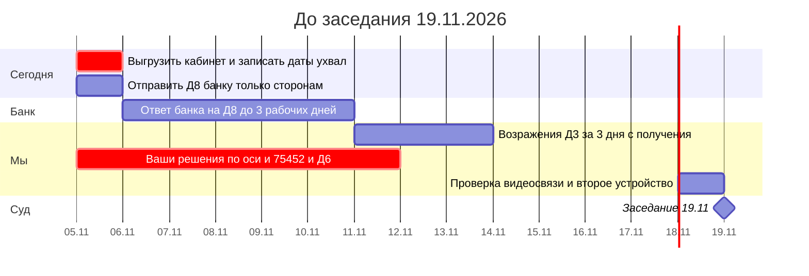
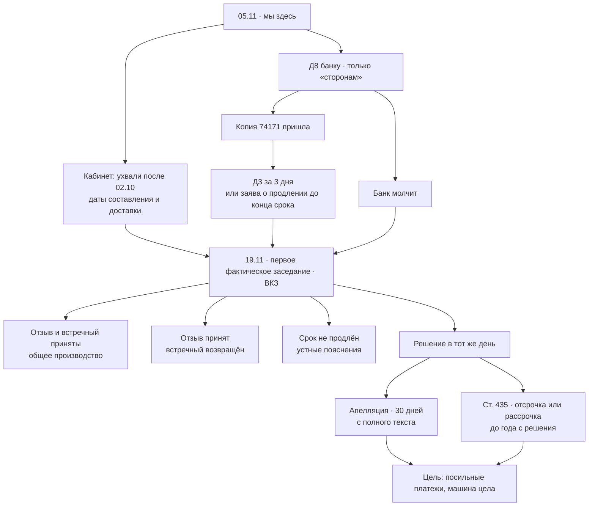
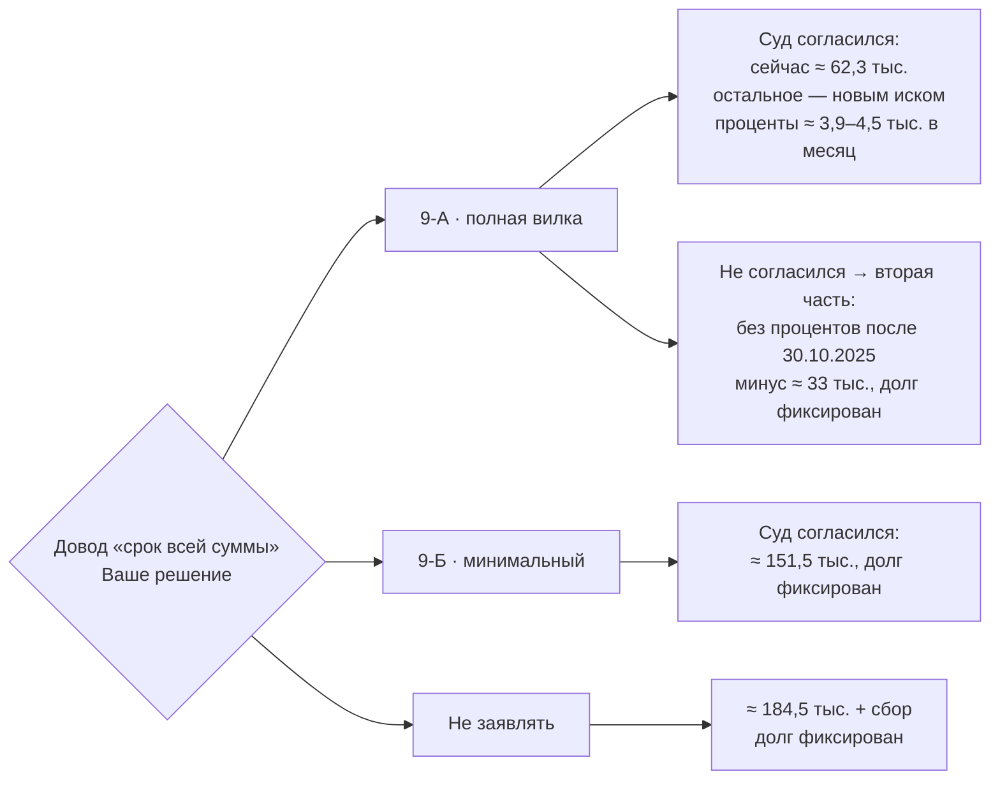
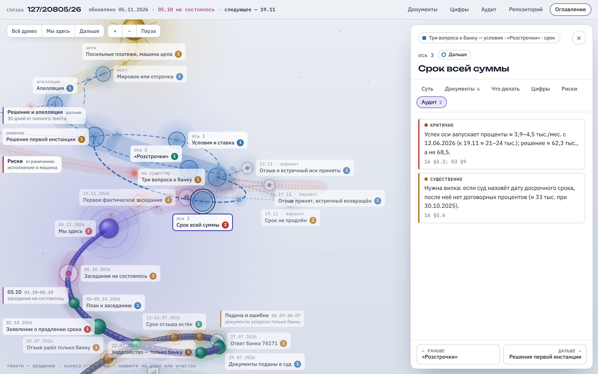
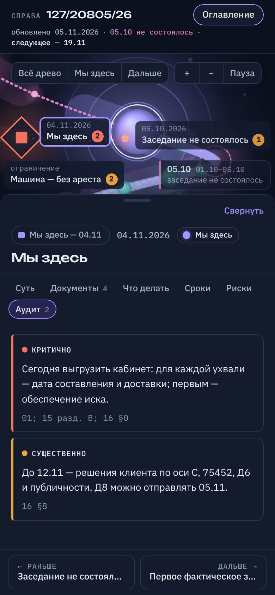

# 17 · Утро 05.11.2026: что сделано за ночь и что дальше

_Сводка для клиента. Подробности — в [аудите 16](16_АУДИТ_СТРАТЕГИИ_2026-11-04.md) (с блоком проверки) и в [01](01_ГДЕ_МЫ_СЕЙЧАС.md). Подготовлено ИИ-ассистентом; практикующий адвокат не проверял. В суд и банку ничего не отправлялось._

Доброе утро. Пока Вы спали, мы с двумя помощниками разобрали всю стратегию по косточкам: один делал независимый аудит, второй — сайт. Потом я всё перепроверил по первоисточникам.

Коротко: **фундамент защиты крепкий.** Но есть одна срочная вещь — сроки — и одно решение, которое можете принять только Вы.

---

## Сегодня: два дела

| # | Что | Зачем | Как |
|---|---|---|---|
| 1 | **Скачать из «Електронного суду» всё, что пришло после 02.10** | Если суд вынес ухвалу без заседания (например, по заявлению от 02.10), срок на жалобу — **15 дней со дня её составления**, а не с получения. Срок мог уже пойти | По [чек-листу реестра 15, раздел В](15_РЕЕСТР_ДОКУМЕНТОВ_СУДА.md). Первым делом — нет ли заявления или ухвалы об обеспечении иска. Для каждой ухвали — **две даты: составления и доставки** в кабинет. Пришлите их мне |
| 2 | **Отправить банку Д8** — запрос копии ответа 74171 | Узнать до 19.11, что банк написал, и подготовить возражения | [Д8](V3_ПАКЕТ/2_ПОСЛЕ_05-10_заготовки/Д8_Запит_банку_копія_74171.txt): нажать **только «Підписати та відправити сторонам»**, в суд не отправлять. Продублировать на e-mail банка из иска. Сохранить квитанцию |

Когда придёт копия от банка — сразу пришлите её: на возражения **3 дня**. [Д3](V3_ПАКЕТ/2_ПОСЛЕ_05-10_заготовки/Д3_Заперечення_ЗАГОТОВКА.txt) уже переделан, заполню его за сутки. Не успеваем — **до окончания** трёх дней подаём короткую заяву о продлении. После окончания это уже нельзя: в июле мы на этом обожглись.

## Путь до 19.11

## Ваше решение до 12.11: довод «срок всей суммы»

Банк сам написал в иске: «письмово вимоги не направлялись». По закону без письменного требования и 30 дней он не может требовать досрочно весь кредит на 240 месяцев. Довод сильный, но **у победы есть цена**. Поэтому решать Вам.

| | 9-А · полная вилка | 9-Б · минимальный | Не заявлять |
|---|---|---|---|
| Что просим | Отказать во взыскании «текущих» 116 019,82 тела и 6 170,56 процентов как преждевременных. Если суд не согласится — не начислять проценты после 91-го дня просрочки | Только вторую часть: вся сумма наступила с 91-го дня (30.10.2025, правило из Условий самого банка), проценты после этой даты не начисляются | — |
| Сумма решения при успехе | ≈ 62 342,25 (остальное — только новым иском) | ≈ 151,5 тыс. (минус ≈ 33 008) | 184 532,63 + сбор |
| Растёт ли долг | **Да:** ≈ 3,9–4,5 тыс. в месяц с 12.06.2026 (к 19.11 ≈ 21–24 тыс.), пока банк не пришлёт письменное требование и не пройдут 30 дней | Нет, пока действует военное положение и ещё 30 дней (сейчас — до 28.02.2027) | Нет, на тех же условиях |
| Выигрыш во времени | Больше: банку нужен второй иск | Обычный путь: апелляция, затем ст. 435 | Обычный путь |
| Рекомендация аудита | При Ваших целях («время важнее умеренной разницы в деньгах») | Если важнее, чтобы долг не рос | — |

Формулировки готовы в Д3, раздел 9. Сейчас в конкретных цифрах ничего не обещаю: как суд оценит части долга, срок которых наступил уже после иска, — вопрос к практикующему адвокату.

**Ещё три решения** (по [аудиту, §8](16_АУДИТ_СТРАТЕГИИ_2026-11-04.md)):
1. **Ходатайство 75452** просит суд истребовать у банка Условия и Тарифы. Ровно этого документа банку сейчас не хватает, чтобы доказать ставку. Рекомендую в этой части его не поддерживать.
2. **Д6** (запрос банку о договорах рассрочек) — не отправлять: договоров рассрочек нет в деле, и это работает на нас.
3. **Сделать репозиторий приватным:** Settings → General → Danger Zone → Change visibility → Private. Сейчас стратегия и Ваши паспортные данные видны любому, в том числе банку.

## Что сделано за ночь

| Файл | Что изменилось |
|---|---|
| [16 · Аудит стратегии](16_АУДИТ_СТРАТЕГИИ_2026-11-04.md) | Независимый аудит: 4 критичных, 15 существенных и 14 умеренных замечаний, привязанных к узлам сайта. Сверху — блок проверки: что подтверждено и что исправлено |
| [Д8 · запрос банку](V3_ПАКЕТ/2_ПОСЛЕ_05-10_заготовки/Д8_Запит_банку_копія_74171.txt) | Убрали ссылки на нормы: они подсказывали банку наши ходы. Добавили просьбу подтвердить, что копия совпадает с документом на 6 листах. **Готов к отправке** |
| [Д3 · возражения](V3_ПАКЕТ/2_ПОСЛЕ_05-10_заготовки/Д3_Заперечення_ЗАГОТОВКА.txt) | Убрали суммы с 2023 года и просьбу истребовать документы. Добавили ответ на № 284/157/20, поправку про «капіталізацію» и возражение против поздних доказательств. Раздел 9 — варианты 9-А / 9-Б |
| [12 · план заседания](12_ЕДИНЫЙ_ПЛАН_ПЕРВОГО_ЗАСЕДАНИЯ.md) | Дополнения к 19.11: сроки, план на сбой связи, два новых устных ответа |
| 01, 13, 03, 09, ЖУРНАЛ | Исправлен срок по ст. 354. Пересчитаны цифры довода. Военное положение — до 29.01.2027. Из реестра 15 удалён Ваш адрес |
| [Сайт дела](https://claude.ai/artifact/W5Cx1KBjnbekysQKmSn3ne) | Спираль на весь экран. Нажатие на участок открывает меню: суть, документы, что делать, сроки, цифры, риски и **аудит**. Ссылка прежняя |

## Что проверено и что нет

- **Проверено по первоисточникам:**
  - статьи 82, 83, 123, 124, 127, 353 и 354 ЦПК — по kodeksy.com.ua;
  - официальный обзор Верховного Суда за 2022 год: № 393/126/20 — паспорт кредита не является договором;
  - выписка и расчёт банка: 91-й день — 30.10.2025, проценты после него ≈ 33 008;
  - Условия банка, приложенные к иску: правило 91-го дня;
  - ходатайство 75452.
- **Исправлено в аудите.** Аудит решил, что на довод банка о № 284/157/20 у нас нет ответа. Ответ есть: Д3, пункт 5.2.
- **Не проверено:**
  - документы в кабинете после 02.10 — их можете скачать только Вы;
  - официальные тексты на zakon.rada.gov.ua: сайт закрыт для облачной среды;
  - полные тексты постанов № 444/9519/12, № 284/157/20 и № 336/8516/15-ц;
  - практика судьи.

---

**Два вопроса к Вам:**
1. Какой вариант по доводу «срок всей суммы» Вам ближе — 9-А, 9-Б или не заявлять?
2. Получится сегодня скачать документы из кабинета и прислать мне даты ухвал и время заседания 19.11?
