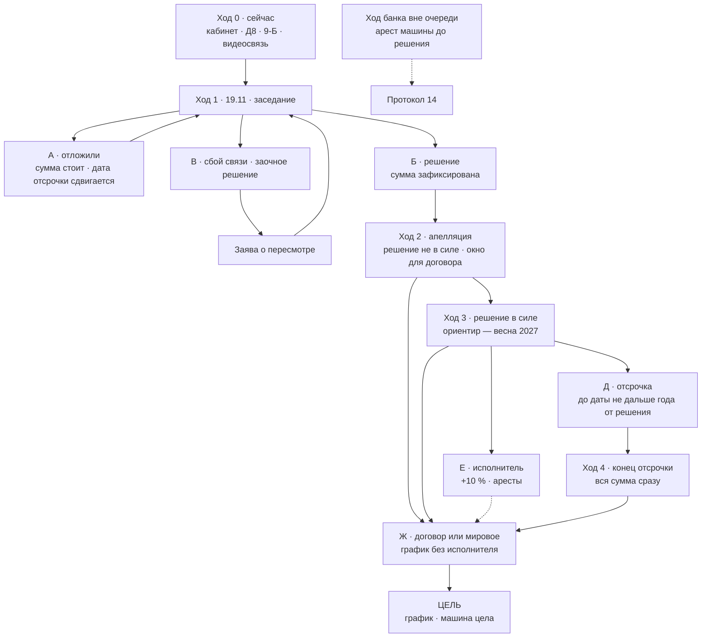

# 18 · Шахматная партия дела: смысловой контур, карта сущностей, ходы (07.11.2026)

_Итог разговора клиента с ИИ-ассистентом в роли адвоката 07.11.2026. Практикующий адвокат не проверял. В суд и банку ничего не направлялось. Файл не заменяет канон (01 → 02 → 13 → 12 → 14): он собирает в одном месте смысл партии, все сущности дела и правила «если → то», чтобы дальше отталкиваться от одного текста. Персональных данных здесь нет. Репозиторий публичный (решение клиента 03.10; рекомендация — закрыть, см. 16 К2)._

---

## 0. Смысл в семи фразах

1. **Решение суда — не взыскание.** Решение — бумага о размере долга. Взыскивает исполнитель, и только по решению, которое вступило в силу.
2. **Наши доводы в суде дают две вещи:** уменьшают сумму и становятся основанием апелляции. Время дают не доводы, а апелляция и отсрочка.
3. **Законом гарантировано одно:** апелляция, поданная вовремя и со сбором, держит решение невступившим, пока апелляционный суд не вынесет постанову. Отсрочка зависит от суда, договор — от банка.
4. **Отсрочка и рассрочка — не дальше года от даты решения.** Апелляция этот год не продлевает. Месяц, честно выигранный до решения, сдвигает конец года на месяц.
5. **Пока сумма зафиксирована, время бесплатное.** Фиксация держится на двух опорах (ВП ВС № 444/9519/12 и п. 18 Прикінцевих та перехідних положень ЦК) и ломается успехом довода 9-А.
6. **Мы играем не на мат, а на выгодную ничью.** Тело долга банк не потеряет: пользование картой мы не отрицаем. Наша победа — график с банком без исполнителя, машина цела.
7. **Честность — не мораль, а ресурс.** Отсрочку даёт тот же суд, и даёт тем, кого считает добросовестным. Отложения — только по настоящим причинам.

## 1. Смысловой контур (эссе)

Денег у клиента сейчас нет, они ожидаются примерно через год. Поэтому дело — не спор «кто прав», а вопрос, **когда и в каком виде** клиенту придётся платить. Банк хочет взыскать сразу. Мы хотим, чтобы к моменту, когда у банка появится право прислать исполнителя, у клиента уже были деньги или подписанный график.

Между иском и исполнителем стоит цепочка, которую нельзя перепрыгнуть: решение → вступление в силу → исполнительный лист → исполнитель. Каждое звено — законный рубеж. До решения рубеж держит сам процесс. После решения — апелляция: пока она идёт, решение не в силе. После вступления в силу — отсрочка суда или договор с банком. Всё, что мы делаем, сводится к тому, чтобы каждое звено проходилось честно и как можно позже, а последнее — исполнитель — не наступило вовсе.

Время в этой цепочке ничего не стоит только при одном условии: сумма не растёт. Она не растёт, если суд взыщет всю сумму: после требования всей суммы договорные проценты не начисляются, а 3 % годовых и инфляционные не начисляются во время военного положения и 30 дней после. Поэтому мы не ломаем фиксацию ради лишних месяцев (раздел 7.1, отказ от 9-А): месяц, купленный по 40,8 % годовых, — плохая сделка для человека, у которого денег нет.

Доводы о ставке, «Розстрочках» и 91-м дне нужны не для отложений. Они уменьшают сумму, а если суд их отклонит, становятся основанием апелляции. Апелляция без оснований — пустая трата сбора и доверия.

Доверие суда — валюта, которой мы заплатим за отсрочку. Поэтому в суде мы говорим ровно то, что есть: картой пользовался, сейчас платить не могу, сумму прошу проверить по доказательствам. Внутренняя позиция и внешняя совпадают. Это и честно, и выгодно.

Финал — не «победа над банком», а договор. Тело долга банк получит в любом случае. Вопрос в том, получит ли он его по посильному графику без исполнителя, или через 10 % сбора и аресты. Сильная позиция в процессе — это то, что делает графику альтернативу хуже для банка.

## 2. Онтология дела — фасеты

Каждая сущность дела описывается шестью фасетами:

| Фасет | Значения |
|---|---|
| Ф1 · Тип | субъект · документ · довод · механизм · событие/срок · сумма · риск · состояние |
| Ф2 · Чья | наша · банка · суда · третьих лиц |
| Ф3 · Статус знания | ФАКТ (с источником) · НЕИЗВЕСТНО · ВЫВОД · РЕШЕНИЕ КЛИЕНТА · ПРЕДЛОЖЕНИЕ |
| Ф4 · На что влияет | время · деньги · машина · доверие суда |
| Ф5 · Фигура | роль на доске (раздел 3) |
| Ф6 · Связи | что включает и что блокирует (раздел 4) |

### 2.1. Субъекты

| Сущность | Чья | Статус | Роль на доске |
|---|---|---|---|
| Клиент (відповідач) | наша | ФАКТ | игрок чёрными |
| АТ «АКЦЕНТ-БАНК» (позивач) | банка | ФАКТ | игрок белыми: сделал первый ход — иск |
| Представитель банка (адвокат по передоручению) | банка | ФАКТ | рука белых |
| Вінницький міський суд, суддя Бессараб Н. М. | суда | ФАКТ | арбитр и часы |
| Вінницький апеляційний суд | суда | будущее | второй арбитр |
| Исполнитель (государственный или частный — не коллектор) | третьих лиц | будущее | превращённая пешка банка (раздел 3) |
| Покупатель долга (коллекторы) | третьих лиц | возможно | замена фигуры: те же права, не больше |

### 2.2. Документы

| Сущность | Чья | Статус | Влияет на | Фигура |
|---|---|---|---|---|
| Иск 14.06.2026 (вх. 58265/26-Вх від 15.06): 184 532,63 + сбор 2 662,40 | банка | ФАКТ | деньги | ♕ ферзь банка |
| Расчёт и выписка (приложения к иску) | банка | ФАКТ | деньги | ♖ ладья банка |
| Паспорт кредита с OTP 18.11.2020: три продукта (46,8 / 44,4 / 40,8 %), 240 месяцев | банка | ФАКТ | деньги | ♖ ладья банка |
| Умови і Правила (витяг): п. 2.1.1.3.5 — списания по другим договорам; п. 2.1.1.12.2 — «з 91-го дня вся заборгованість є простроченою» | банка | ФАКТ | деньги | ♗ слон банка — бьёт и по своим (9-Б) |
| Анкета-заява 21.12.2017 | банка | ФАКТ | деньги | ♙ пешка |
| Відповідь на відзив, вх. 74171 (27.07, почтой, 6 листов) | банка | текст НЕИЗВЕСТЕН | время | ♙ закрытая пешка |
| Ухвала 25.06: упрощённое производство с вызовом; відзив — 15 днів; заперечення — 3 дні з отримання відповіді | суда | ФАКТ | время | правила доски |
| Ухвала 30.07: ВКЗ на 05.10 і всі наступні засідання | суда | ФАКТ | время | правила доски |
| Ухвали после 02.10, повестка на 19.11 | суда | НЕИЗВЕСТНО (не скачаны) | время | закрытые клетки |
| Відзив 75363, зустрічний позов 75449, клопотання 75452 — в суде с 29.07, после срока | наша | ФАКТ | время | ♞ (встречный иск), ♙ |
| Заява 02.10 про продовження строку | наша | ФАКТ; решение суда НЕИЗВЕСТНО | время | ♙ |
| Д8 — запрос банку о копии 74171 | наша | готов, не отправлен | время | ♙ |
| Д3 — заперечення на 74171 (раздел 9 — по решению клиента) | наша | заготовка | деньги | ♙ |
| Д4 — апеляційна скарга (каркас) | наша | заготовка | время | к ♛ |
| Д5 — заява про відстрочку (ст. 435 ЦПК) | наша | заготовка | время, машина | к ♜ |
| Д7 — пропозиція врегулювання | наша | заготовка; переписать | время, деньги | к ♜ |
| Д6 — запит банку про договори «Розстрочок» | наша | НЕ отправлять (16 С1) | — | снятая фигура |
| Д1 — клопотання V3.1 | наша | не подавался; архив | — | снятая фигура |

### 2.3. Доводы

| Довод | Суть простыми словами | Цена | Статус | Фигура |
|---|---|---|---|---|
| А · Ставка и продукт | В паспорте три продукта; какой выбран — не доказано; паспорт — преддоговорная информация (ОП КЦС № 393/126/20) | реально ≈ 393,60; крупно (≈ 59 тыс.) — только если суд строго применит 393/126/20 или исключит паспорт. Риск банка, не прогноз | ВЫВОД | ♝ слон |
| Б · «Розстрочки» | С лимита карты списано 113 161,42 по трём отдельным кредитам; договоров в деле нет | ≈ 34 006 | ВЫВОД | ♝ слон |
| В · Срок всей суммы | Банк сам признал в иске: письменных требований не направлял | см. 9-А и 9-Б | решение клиента | — |
| 9-А · «досрочно требовать было нельзя» | При успехе сейчас взыщут ≈ 62 342,25, но 116 019,82 снова станет обычным кредитом под 40,8 % | ≈ 3,9–4,5 тыс. в месяц, ≈ 50 тыс. в год | ОТКЛОНЁН 07.11 (раздел 7.1) | ломает пешечную структуру |
| 9-Б · «если срок всей суммы наступил — то 30.10.2025» | По правилу 91-го дня из Условий самого банка; проценты после этой даты не взыскиваются | ≈ 33 008 | ПРЕДЛОЖЕНИЕ 07.11; ждёт решения клиента | ♞ конь |
| Г · 74171 не получен | Просить копию и время на возражения (ч. 4 ст. 279 ЦПК) | время | ВЫВОД | ♙ |
| Д · Заявление 02.10 | Продление срока возможно только по инициативе суда (ВП ВС № 914/2848/22) | время | решение суда НЕИЗВЕСТНО | ♙ |
| Поправки к своему отзыву | «Двойной ставки» не было; «капитализации» не было | доверие суда | ВЫВОД | отданная пешка ради позиции |

### 2.4. Механизмы

| Механизм | Что делает | Гарантия | Влияет на | Фигура |
|---|---|---|---|---|
| Апелляция | Пока идёт — решение не в силе (ч. 2 ст. 273 ЦПК). Подать за 30 дней с полного текста; сбор ≈ 3 993,60 (можно просить отсрочку уплаты) | закон | время | ♛ наш ферзь |
| Отсрочка / рассрочка (ст. 435 ЦПК) | Запрет взыскивать до даты / платежи частями — всё не дальше года от даты решения (ч. 5) | усмотрение суда; нужны документы о доходах; суд может назначить обеспечение | время, машина | ♜ ладья |
| Мировое соглашение / договор с банком (ст. 207 ЦПК) | График любой длины; пока соблюдается — исполнителя нет | воля банка | время, деньги, машина | ♜ ладья |
| Фиксация суммы | После требования всей суммы договорные проценты не начисляются (ВП ВС № 444/9519/12); 3 % и инфляционные не начисляются во время военного положения и 30 дней после (п. 18 ПП ЦК) | закон — пока действует военное положение | цена времени | пешечная структура |
| Встречный иск → общий порядок | Если принят — подготовительное производство, плюс месяцы | усмотрение суда (подан после срока) | время | ♞ конь |
| Отложение (ч. 4 ст. 279, ст. 223 ЦПК) | Время ответить на новые материалы | усмотрение суда; только при настоящей причине | время | ♙ |
| Обеспечение иска (ст. 149–150 ЦПК) | Арест имущества до решения — инструмент банка | по заявлению банка | машина | ♘ конь банка |
| Увеличение иска (п. 2 ч. 2 ст. 49 ЦПК) | Банк вправе до начала первого заседания | право банка | деньги | ♘ конь банка |
| Исполнительное производство | +10 % (сбор государственного или вознаграждение частного исполнителя), аресты счетов и имущества | после вступления решения в силу | всё | проходная пешка банка → ферзь |
| Заочное решение (ст. 280) и его пересмотр (ст. 284 ЦПК) | При неявке без уважительной причины; заява о пересмотре — 30 дней | — | время | ловушка |

### 2.5. Суммы и их смысл

| Сумма, грн | Что означает |
|---|---|
| 184 532,63 | Сколько требует банк: тело 131 434,82 + проценты 53 097,81; пени и штрафов нет |
| 131 434,82 | Тело по книгам банка; внутри ≈ 33 956 — комиссии и стоимость рассрочек, а не полученные деньги |
| 116 019,82 | «Текущее» тело: по расчёту банка его срок ещё не наступил — на нём держится 9-А |
| 15 415,00 + 46 927,25 = 62 342,25 | Просроченные тело и проценты: столько взыскали бы сейчас при успехе 9-А |
| ≈ 33 008 | Проценты, начисленные после 91-го дня (с 31.10.2025 по 11.06.2026) — цена 9-Б. Пересчитано 07.11 по `проценты_по_месяцам.csv`: 31 251,11 + 1 616,02 + 140,91 = 33 008,04 |
| ≈ 34 006 | Реальное влияние «Розстрочек» на сумму иска |
| 3 944,67 – 4 468,78 в месяц | Цена успеха 9-А: 40,8 % на текущее / на всё тело |
| ≈ 18 719,50 | 10 % при открытии исполнительного производства (от 187 195,03) |
| ≈ 3 993,60 | Сбор за апелляцию на решение |
| ≈ 532,48 | Сбор за жалобу на отдельную ухвалу |

### 2.6. События и сроки

| Дата | Событие | Статус |
|---|---|---|
| 14.06.2026 | Иск | ФАКТ |
| 25.06.2026 | Открытие производства: упрощённое, с вызовом сторон | ФАКТ |
| 27.06.2026 02:25 | Ухвала доставлена в кабинет; срок отзыва истёк 13–14.07 | ФАКТ |
| 02.07 / 09.07 / 22.07 | Отзыв, встречный иск, ходатайство ушли только банку | ФАКТ |
| 27.07 | Ответ банка 74171 зарегистрирован (почтой, 6 листов) | ФАКТ; текста нет |
| 29.07 | Заседание отменено судом; все документы поданы в суд | ФАКТ; об отмене — со слов клиента |
| 30.07 | ВКЗ разрешена на все последующие заседания | ФАКТ |
| 02.10 | Заявление о продлении срока | ФАКТ |
| 05.10 | Заседание отменено судом | со слов клиента 07.11; документ не скачан |
| **19.11.2026** | Первое фактическое заседание; время и режим — по повестке | со слов клиента |
| +30 дней от полного текста решения | Срок на апелляцию | правило (ст. 354) |
| ориентир — весна 2027 | Вступление решения в силу после апелляции | ОЦЕНКА, не гарантия |
| ≤ 1 год от даты решения | Крайняя дата отсрочки или последнего платежа рассрочки | правило (ч. 5 ст. 435) |
| 29.01.2027 | Конец текущего продления военного положения; п. 18 ПП ЦК действует минимум до 28.02.2027 | ФАКТ по нескольким новостным источникам (проверено 07.11); номера законов (№ 5029, 5030 — по dtkt) с официальным текстом не сверены |

### 2.7. Риски

| Риск | Где на доске | Ответ |
|---|---|---|
| Пропущен 15-дневный срок на ухвалу, вынесенную без заседания | ход 0 | Скачать кабинет; для каждой ухвали — дата составления и дата доставки (ч. 1–2 ст. 354 ЦПК) |
| Арест машины до решения (обеспечение иска) | ход вне очереди | Протокол 14: соразмерность, работа в такси, единственный источник дохода |
| Сбой видеосвязи → заочное решение | ход 1 | Проверка накануне, второе устройство, телефон секретаря; при сбое — сразу заява в ЄСІТС |
| Отказ в отсрочке | ход 3 | Параллельно и заранее — переговоры с банком |
| Исполнитель раньше денег | ход 3 | Договор до передачи листа; защита машины как средства заработка (не автоматически) |
| Конец военного положения | фон | Ещё 30 дней защиты, затем 3 % годовых и инфляционные на сумму решения — не 40,8 % |
| Публичный репозиторий | фон | Сделать приватным; агентам подключать отдельно |
| Ход «ради времени» без настоящей причины | любой | Не делать: ст. 44 и 148 ЦПК и потеря отсрочки |

### 2.8. Состояния партии

| Состояние | Описание | Взыскание возможно? |
|---|---|---|
| S0 | До решения (сейчас) | Нет — кроме обеспечения иска |
| S1 | Решение вынесено, идёт срок на апелляцию | Нет |
| S2 | Апелляция рассматривается | Нет |
| S3 | Решение в силе, отсрочки и договора нет | **Да** |
| S4 | Действует отсрочка | Нет — до назначенной даты |
| S5 | Открыто исполнительное производство | Идёт: +10 %, аресты |
| S6 | Договор или мировое, график соблюдается | Нет — **цель** |

## 3. Доска: фигуры

Белые — банк (первый ход — иск). Чёрные — мы. Суд — арбитр и часы.

| Фигура | Белые — банк | Чёрные — мы |
|---|---|---|
| ♔ Король | Тело долга (131 тыс.). Мы его не атакуем: пользование картой не отрицаем. Мат банку невозможен — на него мы не играем | Доход: автомобиль, которым клиент зарабатывает. Мат — арест машины и счетов исполнителем |
| ♕ Ферзь | Иск с расчётом: 184 532,63 | Апелляция — единственная фигура, сила которой гарантирована законом |
| ♖ Ладьи | Паспорт с OTP; расчёт и выписка | Отсрочка/рассрочка (ст. 435); договор или мировое с банком |
| ♗ Слоны | Умови і Правила; практика ВС № 284/157/20 и ч. 2 ст. 1050 ЦК | Довод А (ставка, продукт); довод Б («Розстрочки») |
| ♘ Кони | Обеспечение иска (арест машины) — может прыгнуть в любой момент; увеличение иска до первого заседания | 9-Б — прыжок через правило 91-го дня самого банка; встречный иск — прыжок в общий порядок |
| ♙ Пешки | Ответ 74171, анкета 2017, SMS и звонки | Д8, Д3, заявление 02.10, готовность к ВКЗ, документы о доходах |
| Пешечная структура | — | Фиксация суммы (ВП ВС № 444/9519/12 + п. 18 ПП ЦК). Определяет характер всей партии: пока цела, время бесплатное |
| Проходная пешка | Будущий исполнительный лист. Дойдёт до последней горизонтали (исполнителя) — превратится во второго ферзя: +10 % и аресты | Блокируем её: ферзь (апелляция), ладьи (отсрочка, договор) |
| Снятые фигуры | — | «Двойная ставка», «капитализация», «банк дал 24 тыс.», «OTP поддельный», Д1, Д6, 9-А, 75452 в части Условий и Тарифов |

**Почему мы играем на ничью.** Мат банку — это отказ во взыскании тела долга. Он невозможен: карта использовалась, OTP не оспаривается. Наша «ничья» — договор, где банк получает своё по графику, а клиент — время и целую машину. Каждый ход оценивается одним вопросом: приближает ли он эту позицию.

## 4. Правила «если → то»

1. Если решение не вступило в силу → исполнителя нет.
2. Если апелляция подана вовремя и со сбором → решение не в силе до постановы апелляционного суда.
3. Если апелляцию не подать → решение вступает в силу после срока на обжалование.
4. Если решение в силе, а отсрочки и договора нет → банк может нести лист исполнителю: +10 %, аресты.
5. Если суд дал отсрочку → взыскания нет до даты; после неё — вся сумма сразу.
6. Если суд дал рассрочку → частями, но всё до той же даты, не дальше года от решения.
7. Если нужен график дольше года → только договор с банком. Суд этого не может.
8. Если решение вынесено на месяц позже → крайняя дата отсрочки тоже на месяц позже.
9. Если суд взыскал всю сумму (довод не заявлен или заявлен 9-Б) → сумма зафиксирована: договорные проценты не идут, 3 % и инфляционные не начисляются, пока действует п. 18.
10. Если выигран 9-А → 116 019,82 снова под 40,8 %, ≈ 4 тыс. в месяц; рост останавливает только письменное требование банка, а когда его слать, решает банк; решение на ≈ 62 тыс. исполняется в обычные сроки — машина под тем же риском.
11. Если просить отсрочку прямо 19.11 (ст. 267 ЦПК) → суд может одновременно обеспечить исполнение, то есть арестовать имущество. Поэтому 19.11 не просим.
12. Если просить отложение без настоящей причины → ст. 44 и 148 ЦПК и потеря доверия суда, а с ним — шанса на отсрочку.
13. Если банк прислал 74171 → 3 дня на заперечення (Д3); не успеваем → заява о продлении ДО окончания срока (ч. 2 ст. 127 ЦПК).
14. Если суд вынес ухвалу без заседания → 15 дней со дня составления полного текста (ч. 1 ст. 354); с вручения — только с просьбой о поновлении (ч. 2).
15. Если связь сорвалась, а отзыв не принят → риск заочного решения (ст. 280; банк в иске не возражал) → заява о пересмотре.
16. Если банк продаст долг → покупатель получает те же права, не больше.
17. Если военное положение закончится → ещё 30 дней защиты, затем 3 % годовых и инфляционные на сумму решения.

## 5. Партия до сих пор

| Ход | Белые (банк) и суд | Чёрные (мы) | Оценка |
|---|---|---|---|
| 1 | 14.06 — иск: ферзь вышел | — | |
| 2 | 25.06 — суд открыл упрощённое производство | 02.07 — отзыв; 09.07 — встречный иск; 22.07 — ходатайство: всё ушло только банку | Наша ошибка: фигуры не дошли до доски (не выполнен второй шаг в ЄСІТС) |
| 3 | 27.07 — ответ 74171 почтой | 29.07 — всё подано в суд, после срока | Ответ банка зарегистрирован через 25 дней после того, как банк получил отзыв; когда он отправлен — неизвестно, поэтому об опоздании банка не утверждаем |
| 4 | 29.07 — суд отменил заседание; 30.07 — разрешил ВКЗ | — | |
| 5 | — | 02.10 — заявление о продлении срока | Путь один — продление по инициативе суда |
| 6 | 05.10 — суд отменил заседание; назначено 19.11 | — | Решения суда по нашим документам неизвестны |
| 7 | — | **наш ход — сейчас** | Кабинет, Д8, решение по 9-Б, видеосвязь |

## 6. Дерево ходов

**Ход 0 — до 19.11 (наш).** Скачать «Електронний суд» после 02.10: обеспечение иска — первым; для каждой ухвали — дата составления и дата доставки; повестка — время и режим. Отправить Д8. Решить по 9-Б (лучше до 12.11). Проверить видеосвязь. Закрыть репозиторий.
_Ответные ходы банка:_ прислать 74171 (→ Д3 за 3 дня); увеличить иск до заседания (→ возражаем: после требования всей суммы проценты не начисляются, ВП ВС № 444/9519/12); попросить арест машины (→ протокол 14).

**Ход 1 — 19.11.**
- **А · Отложение:** встречный иск принят; время на ответ по 74171; новые документы банка. Для нас плюс: сумма стоит, крайняя дата отсрочки сдвигается.
- **Б · Решение в тот же день.** Сумма зависит от доводов А, Б и 9-Б.
- **В · Сбой связи → заочное решение → заява о пересмотре.**

Реалистично — одно отложение, максимум два, и только по настоящим причинам. Год дают не заседания, а цепочка «решение → апелляция → отсрочка».

**Ход 2 — решение есть.** Апелляция за 30 дней; её основание — наши доводы, которые суд отклонил. Несколько месяцев решение не в силе. Это лучшее окно для переговоров с банком: взыскать он пока не может. Документы о доходах собираем уже сейчас.

**Ход 3 — решение вступило в силу (ориентир — весна 2027).** Гонка двух ходов: наше заявление об отсрочке — сразу, в день вступления; лист банка — исполнителю. Параллельно — договор.
- **Д · Отсрочка дана** → тишина до даты, не дальше года от решения.
- **Е · Отказ или банк оказался быстрее** → исполнитель: +10 %, аресты → договор (банк может отозвать лист) и защита машины как средства заработка.
- **Ж · Договор или мировое** → график.

**Ход 4 — отсрочка закончилась.** Вся сумма сразу → оплата или Ж.

**Главная линия:** Б (или А → Б) → апелляция → Д → Ж. Пример: решение 19.11.2026 → апелляция примерно до весны 2027 → отсрочка не дальше 19.11.2027 → до этой даты — договор о графике. Если суд один раз отложит дело до января–февраля 2027, вся линия сдвигается на те же месяцы. Это ориентиры, не обещания.

### Оценки узлов (не прогноз и не гарантия)

| Узел | Оценка | Почему |
|---|---|---|
| Решение 19.11 в тот же день | вероятно | 60-дневный срок упрощённого производства (ст. 275 ЦПК) давно прошёл; два заседания уже отменены |
| Отложение 19.11 | возможно | если 74171 не получен, если банк принесёт новое, если примут встречный иск |
| Встречный иск принят | маловероятно | подан после срока; продление — только по инициативе суда |
| Довод Б («Розстрочки») | реальный шанс на частичный успех | договоров в деле нет, но в Условиях есть общий механизм списаний |
| Довод А в крупном варианте | маловероятно | паспорт подписан OTP; все три ставки не ниже 40,8 % |
| 9-Б | невысокий шанс, нулевая цена неудачи | банк ответит, что 91-й день — бухгалтерская категория, а всю сумму он потребовал иском |
| Отсрочка по ст. 435 | возможно | зависит от документов и добросовестности; банк будет возражать |
| Договор с банком | возможно | ВЫВОД: при зафиксированной сумме графику у банка одна альтернатива — медленное исполнение с риском для обеих сторон |

## 7. Что решено и понято 07.11

### 7.1. «Срок всей суммы» — пересмотрен с нуля

- **9-А отклонён.** Он не отодвигает момент, когда против клиента появится исполнимое решение: решение на ≈ 62 тыс. вступит в силу в те же сроки, и машина окажется под тем же риском. 9-А лишь переносит 116 тыс. за горизонт клиента и делает их дороже на ≈ 4 тыс. в месяц. Довод аудита «время важнее умеренной скидки» здесь не работает: выбор не «скидка против времени», а «рост долга ради времени, которое не нужно». По сути это возврат к выводу V3 (PR #1: «досрочное взыскание в суде не заявляем»), уточнённый.
- **9-Б — бесплатная попытка снять ≈ 33 тыс., не ломая фиксацию.** Слабое место: банк скажет, что 91-й день — бухгалтерская категория, а всю сумму он потребовал иском 14.06.2026; тогда выигрыш — ноль.
- **Уточнение формы.** 9-Б подаётся условно и без утверждения, что срок не наступил: такое утверждение и есть 9-А. Предлагаемая редакция раздела 9 Д3 (заменит 9-А/9-Б после письменного решения клиента):

> «Не визнаючи позову в заявленому розмірі, звертаю увагу суду: позивач обґрунтовує вимогу про стягнення всієї суми кредиту частиною другою статті 1050 ЦК України та своїм правом вимагати дострокового виконання. Відповідно до пункту 2.1.1.12.2 Умов і Правил у редакції, доданій позивачем до позову, «починаючи з 91-го дня вся (загальна) заборгованість за Кредитом є простроченою». За розрахунком позивача безперервне прострочення почалося 01.08.2025, отже 91-й день настав 30.10.2025. Тому якщо строк повернення всієї суми кредиту настав, то не пізніше 30.10.2025. Після настання цього строку проценти за договірною ставкою не нараховуються (постанова Великої Палати Верховного Суду від 28.03.2018 у справі № 444/9519/12), а відповідальність за частиною другою статті 625 ЦК України виключена пунктом 18 Прикінцевих та перехідних положень ЦК України. Неоднозначні умови договору, сформульовані банком, тлумачаться на користь споживача [норму сверить: ч. 8 ст. 18 Закону «Про захист прав споживачів»; ОП КЦС № 552/672/23]. Прошу відмовити у стягненні процентів, нарахованих після 30.10.2025, у сумі [33 008,04 — звірити за розрахунком позивача] грн.»

- Решение клиента ещё не получено. До решения Д3 не меняется.

### 7.2. Заседания и время

- «3–4 заседания по 2–3 месяца — плюс год» нереалистично. Дело упрощённое, 60-дневный срок давно прошёл, суд торопится.
- Реалистично — одно отложение, максимум два, и только по настоящей причине: 74171 не получен; банк принёс новые документы; принят встречный иск (общий порядок — единственное, что может дать сразу несколько месяцев).
- Доводы о ставке, рассрочках и 91-м дне отложения сами не дают. Их ценность — сумма и основания апелляции.
- Год дают не заседания, а цепочка «решение → апелляция → отсрочка». Заседания добавят сверху месяца 2–4, если повезёт.

### 7.3. Отсрочка — как она устроена

- Считается **от даты решения**, а не от даты, когда суд её дал. Решение 19.11.2026 → крайняя дата 19.11.2027, даже если отсрочку дадут весной.
- Отсрочка: до даты не взыскивают, после неё — вся сумма сразу. Рассрочка: частями, но всё до той же даты.
- «Год ничего не платить, потом частями несколько лет» — только по договору с банком.
- **Не гарантирована:** суд решает сам, банк возражает. Нужны правдивые документы о доходах (справка из кабинета налогоплательщика за 2025–2026 годы, расходы, иждивенцы, жильё, временный характер трудностей).
- 19.11 об отсрочке и рассрочке не говорим. Подаём заявление сразу, как решение вступит в силу.

### 7.4. Договор с банком

- Лучшее окно — пока идёт апелляция: взыскать банк ещё не может.
- Крайний срок — до того, как банк передаст лист исполнителю; после этого к долгу добавляются 10 %.
- Форма — мировое соглашение, утверждённое апелляционным судом, или письменный договор с обязательством банка не предъявлять лист, пока соблюдается график.
- Начинать заранее, а не после отказа в отсрочке.

### 7.5. Что считаем твёрдо

Гарантировано законом только одно: пока идёт апелляция, поданная вовремя и со сбором, взыскания нет. Ориентир — примерно до весны 2027. Всё дальше — то, за что мы боремся, а не обещание.

### 7.6. Репозиторий

- Публичный. Рекомендация — сделать приватным (16 К2): персональные данные в приложениях банка и стратегия видны любому.
- `main` отстаёт (02.10). PR #1–#5 и этот PR идут стопкой: #1 → #2 → #3 → #4 → #5 → этот.

## 8. Что дальше — до 19.11

| # | Действие | Кто | Когда |
|---|---|---|---|
| 1 | Скачать «Електронний суд» после 02.10: обеспечение — первым; ухвали — дата составления и дата доставки; повестка на 19.11 — время и режим | клиент | выходные 07–08.11 |
| 2 | Отправить Д8 (только «Підписати та відправити сторонам» + e-mail банка) | клиент | сразу |
| 3 | Решение по 9-Б в условной форме — записать в ЖУРНАЛ | клиент | лучше до 12.11 |
| 4 | Переписать раздел 9 Д3 под решение | агент | после п. 3 |
| 5 | Пришёл 74171 → Д3 за 3 дня; не успеваем → заява о продлении до конца срока | клиент и агент | по событию |
| 6 | Проверить видеосвязь, второе устройство, телефон секретаря | клиент | 18.11 |
| 7 | Сделать репозиторий приватным | клиент | сразу |
| 8 | Начать собирать документы о доходах для отсрочки | клиент | с ноября |
| 9 | Параметры договора с банком: какая ежемесячная сумма реальна и с какого месяца | клиент | до решения |
| 10 | Час консультации практикующего адвоката (вопросы — 16 §9) | клиент | до 19.11, по возможности |

## 9. Словарь простыми словами

- **Решение суда** — бумага, где суд пишет, сколько Вы должны. Само по себе ничего не забирает.
- **Вступление в силу** — момент, с которого решение можно исполнять: через 30 дней, если его не обжаловали, или после постановы апелляционного суда.
- **Апелляция** — жалоба в апелляционный суд. Пока её рассматривают, решение не в силе.
- **Исполнительный лист** — документ, который банк получает в суде после вступления решения в силу и несёт исполнителю.
- **Исполнитель** — государственный или частный, не коллектор. Открывает производство: +10 %, аресты счетов и имущества.
- **Отсрочка** — суд запрещает взыскивать до определённой даты, не дальше года от решения. После неё — вся сумма сразу.
- **Рассрочка** — суд разрешает платить частями, но всё — до той же даты.
- **Мировое соглашение, договор** — график, о котором Вы договорились с банком. Единственный путь к платежам дольше года.
- **Фиксация суммы** — после требования всей суммы банк не может начислять договорные проценты, а 3 % годовых и инфляционные не начисляются во время военного положения и 30 дней после.
- **Обеспечение иска** — арест имущества до решения по просьбе банка. Отдельный риск, проверяем перед каждым заседанием.
- **Заочное решение** — решение без Вас, если Вы не подключились без уважительной причины. Его можно пересмотреть по заявлению.
