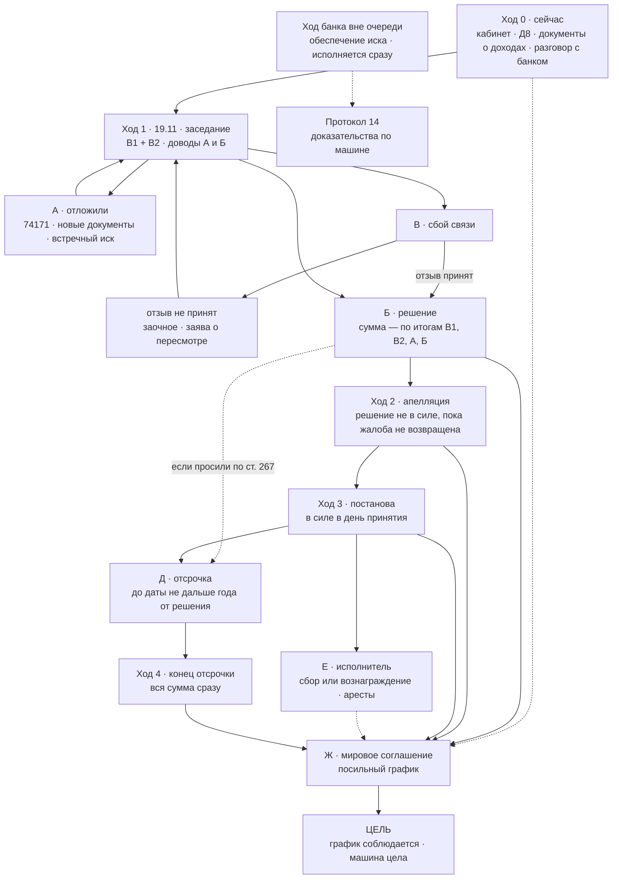

# 18 · Шахматная партия дела: смысл, сущности, ходы — финальная редакция (08.11.2026)

_Итог разговоров клиента с ИИ-ассистентом в роли адвоката 07–08.11.2026 и трёх независимых разборов первой редакции этого файла (Codex — два ответа, GPT — один), которые передал клиент. Практикующий адвокат не проверял. В суд и банку ничего не направлялось. Это действующая редакция: выводы, которые разборы опровергли, удалены, а не оставлены рядом. Какие пункты более ранних документов она заменяет — §11; статус каждого источника — §10. Канон по-прежнему 01 → 02 → 13 → 12 → 14; этот файл сводит смысл партии в одном месте. Персональных данных здесь нет. Репозиторий публичный (решение клиента 03.10); рекомендация — закрыть (16 К2)._

---

## 0. Смысл в девяти фразах

1. **Решение суда — не взыскание.** Решение — бумага о размере долга. Взыскивает исполнитель, и только по решению, которое вступило в силу. Исключение — ухвала об обеспечении иска: её исполняют сразу.
2. **По «сроку всей суммы» заявляем два возражения, не выбирая между ними.** В1: банк не доказал, что вся сумма уже подлежит возврату, — значит, сейчас только просроченное. В2: если суд всё же применит Условия банка, то по этим же Условиям проценты перестали начисляться 30.10.2025 (≈ 33 тыс. по расчёту банка). Банк не может одновременно взыскивать всю сумму как наступившую и начислять на неё проценты как на ненаступившую.
3. **Лишнего не признаём.** Даты и суммы — «за розрахунком позивача», Условия — «не визнаючи їх частиною договору»: признанное в документе суд уже не проверяет (ч. 1 ст. 82 ЦПК).
4. **Растёт ли долг после решения, зависит от ветки, а не от самого решения.** Если суд взыщет всю сумму, обычные проценты прекращены, а ответственность по ст. 625 ЦК сейчас исключена — время дешёвое. Если суд примет В1, остаток остаётся обычным кредитом — время не бесплатное.
5. **Апелляция держит решение невступившим**, если подана вовремя, сбор уплачен, жалобу не вернули, в открытии не отказали и производство не закрыли (ч. 2 ст. 273 ЦПК). Постанова апелляционного суда вступает в силу в день принятия (ст. 384) — к этому дню всё должно быть готово.
6. **Отсрочка — не дальше года от даты решения**, не гарантирована и сама машину не защищает: суд при ней вправе обеспечить исполнение. Просить ли её прямо в решении (ст. 267) — решаем, когда будут документы о доходах.
7. **С банком говорим уже сейчас.** Мировое соглашение, утверждённое судом, само становится исполнительным документом — график в нём только посильный. Частный договор решение суда не отменяет.
8. **Мы играем не на мат, а на выгодную ничью.** Тело долга банк не потеряет: пользование картой мы не отрицаем. Наша победа — посильный график без исполнителя, машина цела.
9. **Честно о главном.** Жёсткое условие клиента — ноль платежей сейчас и ни одной отметки на машине — ни одна ветвь сама не гарантирует. Мы снижаем вероятность плохого исхода: доказательства, доверие суда, переговоры. Отложения — только по настоящим причинам.

## 1. Смысловой контур (эссе)

Денег у клиента сейчас нет, они ожидаются примерно через год. Поэтому дело — не спор «кто прав», а вопрос, **когда и в каком виде** клиенту придётся платить. Банк хочет взыскать сразу. Мы хотим, чтобы к моменту, когда у банка появится право прислать исполнителя, у клиента уже были деньги или подписанный посильный график — и машина, которой он зарабатывает, осталась без отметок.

Между иском и исполнителем стоит цепочка: решение → вступление в силу → исполнительный лист → исполнитель. Каждое звено — законный рубеж. До решения рубеж держит сам процесс. После решения — апелляция, если она подана надлежаще. После вступления в силу — отсрочка суда или мировое соглашение с банком. Отдельно от цепочки стоит обеспечение иска: банк может попросить арест или запрет до решения, и такую ухвалу исполняют сразу. Поэтому машину защищает не цепочка, а доказательства (протокол 14) и то, что мы не даём банку повода.

Время в этой цепочке не бесплатное по умолчанию. Дорожает ли оно, решает ось «срок всей суммы». Если суд взыщет всю сумму, обычные проценты прекратились с даты, когда наступил срок, а ответственность за просрочку сейчас исключена законом — сумма почти не растёт. Если суд согласится, что вся сумма не наступила, сейчас взыщут только просроченное, а остаток ≈ 116 тыс. останется обычным кредитом: банк сможет начислять на него проценты по ставке, которую докажет, и потребовать его позже. Это не повод молчать: суд сам применяет закон, а решение на 62–69 тыс. вместо 151–184 тыс. — это меньшее исполнение и меньший риск. Поэтому мы не выбираем, а заявляем оба возражения и даём работать собственным противоречиям банка.

Доводы о ставке, «Розстрочках» и сроке нужны не для отложений. Они уменьшают сумму, а если суд их отклонит, становятся основанием апелляции. Новые доказательства в апелляции принимают лишь в исключительных случаях (ч. 3 ст. 367 ЦПК), поэтому всё нужное — получить и заявить в первой инстанции.

Доверие суда — валюта, которой мы заплатим за отсрочку. Поэтому в суде мы говорим ровно то, что есть: картой пользовался, сейчас платить не могу, сумму прошу проверить по доказательствам. Внутренняя позиция и внешняя совпадают. Это и честно, и выгодно.

Финал — не «победа над банком», а договор. Тело долга банк получит в любом случае. Вопрос в том, получит ли он его по посильному графику без исполнителя или через расходы исполнительного производства и аресты. Сильная позиция в процессе — это то, что делает альтернативу графику хуже для банка.

## 2. Онтология дела — фасеты

Каждая сущность дела описывается шестью фасетами:

| Фасет | Значения |
|---|---|
| Ф1 · Тип | субъект · документ · довод · механизм · событие/срок · сумма · риск · состояние |
| Ф2 · Чья | наша · банка · суда · третьих лиц |
| Ф3 · Статус знания | ФАКТ (с источником) · НЕИЗВЕСТНО · ВЫВОД · РЕШЕНИЕ КЛИЕНТА · ПРЕДЛОЖЕНИЕ |
| Ф4 · На что влияет | время · деньги · машина · доверие суда |
| Ф5 · Фигура | роль на доске (раздел 3) |
| Ф6 · Связи | что включает и что блокирует (раздел 5) |

### 2.1. Субъекты

| Сущность | Чья | Статус | Роль на доске |
|---|---|---|---|
| Клиент (відповідач) | наша | ФАКТ | игрок чёрными |
| АТ «АКЦЕНТ-БАНК» (позивач) | банка | ФАКТ | игрок белыми: сделал первый ход — иск |
| Представитель банка (адвокат по передоручению) | банка | ФАКТ | рука белых |
| Вінницький міський суд, суддя Бессараб Н. М. | суда | ФАКТ | арбитр и часы |
| Вінницький апеляційний суд | суда | будущее | второй арбитр |
| Исполнитель (государственный или частный — не коллектор) | третьих лиц | будущее | превращённая пешка банка (раздел 3) |
| Покупатель долга (коллекторы) | третьих лиц | возможно | замена фигуры: те же права, не больше |

### 2.2. Документы

| Сущность | Чья | Статус | Влияет на | Фигура |
|---|---|---|---|---|
| Иск 14.06.2026 (вх. 58265/26-Вх від 15.06): 184 532,63 + сбор 2 662,40; вся сумма — по ч. 2 ст. 1050 ЦК и п. 2.1.1.4.2 Условий; «письмово вимоги не направлялись» | банка | ФАКТ | деньги | ♕ ферзь банка |
| Расчёт и выписка (приложения к иску): 116 019,82 тела и 6 170,56 процентов ведутся как «текущие» | банка | ФАКТ | деньги | ♖ ладья банка |
| Паспорт кредита с OTP 18.11.2020: три продукта (46,8 / 44,4 / 40,8 %), 240 месяцев | банка | ФАКТ | деньги | ♖ ладья банка |
| Умови і Правила (витяг, додаток до позову): п. 2.1.1.3.5 — списания по другим договорам; п. 2.1.1.4.2 — право требовать досрочно; п. 2.1.1.12.2 — «починаючи з 91-го дня вся (загальна) заборгованість за Кредитом є простроченою»; п. 2.1.1.12.2.1 — двойная ставка на просроченное; п. 2.1.1.12.4 — «Строк користування кредитом становить 20 років»; п. 2.1.1.12.7.3 — проценты «до дня, коли Кредит (кредитний ліміт) і / або Овердрафт стають простроченими кредитами» | банка | ФАКТ (текст); клиентом не подписаны | деньги | ♗ слон банка — бьёт и по своим (В2) |
| Анкета-заява 21.12.2017 | банка | ФАКТ | деньги | ♙ пешка |
| Відповідь на відзив, вх. 74171 (27.07, почтой, 6 листов) | банка | текст НЕИЗВЕСТЕН | всё: может закрыть пробелы банка | ♙ закрытая пешка |
| Ухвала 25.06: упрощённое производство с вызовом; відзив — 15 днів; заперечення — 3 дні з отримання відповіді | суда | ФАКТ | время | правила доски |
| Ухвала 30.07: ВКЗ на 05.10 і всі наступні засідання | суда | ФАКТ | время | правила доски |
| Ухвали после 02.10, повестка на 19.11 | суда | НЕИЗВЕСТНО (не скачаны) | время, машина | закрытые клетки |
| Відзив 75363, зустрічний позов 75449, клопотання 75452 — в суде с 29.07, после срока | наша | ФАКТ | время | ♙ |
| Заява 02.10 про продовження строку | наша | ФАКТ; решение суда НЕИЗВЕСТНО | время | ♙ |
| Д8 — запрос банку о копии 74171 | наша | готов, не отправлен | время | ♙ |
| Д3 — заперечення на 74171; раздел 9 — оба возражения, В1 и В2 (08.11) | наша | заготовка; подавать после 74171 | деньги | ♖♖ |
| Д4 — апеляційна скарга (каркас) | наша | заготовка | время | к ♕ |
| Д5 — заява про відстрочення (ст. 435; при решении — ст. 267) | наша | заготовка | время, машина | к ♘ |
| Д7 — пропозиція врегулювання (переписана 08.11) | наша | заготовка; отправка — по решению клиента | время, деньги, машина | к ♘ |
| Д6 — запит банку про договори «Розстрочок» | наша | НЕ отправлять (16 С1) | — | снятая фигура |
| Д1 — клопотання V3.1 | наша | не подавался; архив | — | снятая фигура |

### 2.3. Доводы

| Довод | Суть простыми словами | Цена (что даёт при успехе) | Статус | Фигура |
|---|---|---|---|---|
| А · Ставка и продукт | В паспорте три продукта; какой выбран — не доказано; паспорт — преддоговорная информация (ОП КЦС № 393/126/20; в этой части она отступила от № 284/157/20) | реально ≈ 393,60; крупно (≈ 59 тыс.) — только если суд строго применит № 393/126/20 или исключит паспорт. Риск банка, не прогноз | ВЫВОД | ♗ слон |
| Б · «Розстрочки» | С лимита карты списано 113 161,42 по трём отдельным кредитам; договоров в деле нет | ≈ 34 006; с В2 частично пересекается — не складывать без проверки | ВЫВОД | ♗ слон |
| В1 · Вся сумма ещё не наступила | Письменного уведомления по ч. 4 ст. 16 Закона не было — банк сам признал это в иске; право досрочного требования в подписанном договоре не доказано (Условия не подписаны; ВС № 539/402/24) | сейчас — только просроченное: 68 512,81 или 62 342,25 (§2.5); остаток ≈ 116 тыс. — обычный кредит | ВЫВОД; концепция принята клиентом 08.11 | ♖ ладья |
| В2 · Если срок наступил — проценты прекратились | По Условиям самого банка с 91-го дня (30.10.2025) вся задолженность просрочена (п. 2.1.1.12.2), а проценты начисляются только до этого дня (п. 2.1.1.12.7.3). Двойная ставка (п. 2.1.1.12.2.1) — повышение ставки из-за нарушения; ответственность по ст. 625 сейчас исключена | ≈ 33 008,04 по расчёту банка; точно — после пересчёта с распределением платежей после этой даты | ВЫВОД; концепция принята клиентом 08.11 | ♖ ладья |
| Г · 74171 не получен | Просить копию и время на возражения (ч. 4 ст. 279 ЦПК) | время | ВЫВОД | ♙ |
| Д · Заявление 02.10 | Продление срока возможно только по инициативе суда (ВП ВС № 914/2848/22) | время | решение суда НЕИЗВЕСТНО | ♙ |
| Поправки к своему отзыву | «Двойной ставки» не было; «капитализации» не было | доверие суда | ВЫВОД | отданная пешка ради позиции |

### 2.4. Механизмы

| Механизм | Что делает | Гарантия | Влияет на | Фигура |
|---|---|---|---|---|
| Апелляция | Решение не вступает в силу, пока жалобу не вернули, в открытии не отказали и производство не закрыли (ч. 2 ст. 273 ЦПК). Подать — 30 дней с полного текста (ст. 354); сбор ≈ 3 993,60, можно просить отсрочку уплаты. Срок рассмотрения — 60 дней с открытия, в исключительных случаях ещё до 15 (ст. 371). Постанова — в силе в день принятия (ст. 384). Кассация исполнение сама не останавливает | закон — при надлежащей жалобе; длительность не гарантирована | время | ♕ наш ферзь |
| Отсрочка / рассрочка | При решении (ст. 267) или после (ст. 435): не взыскивать до даты / платить частями — всё не дальше года от даты решения (ч. 5 ст. 435). Суд вправе при этом обеспечить исполнение. Заявление само исполнение не останавливает; рассматривается до 20 дней (по двум разборам — сверить) | усмотрение суда; нужны документы о доходах и о будущем источнике оплаты | время, машина | ♘ конь |
| Мировое соглашение (ст. 207 ЦПК) | Возможно на любой стадии. В апелляции решение первой инстанции признаётся нечинним, производство закрывается (ст. 373). Ухвала об утверждении — исполнительный документ (ст. 208): нарушен график — взыскание без нового суда. График может быть дольше года | воля банка | время, деньги, машина | ♘ конь |
| Частный договор с банком | Решение суда не отменяет. Если решение в силе, банк может не предъявлять лист или отозвать его у исполнителя, но вправе предъявить снова | воля банка | время | слабее мирового |
| Сумма после решения | Обычные проценты (ст. 1048 ЦК) прекращаются, когда срок кредита окончился или надлежаще изменён (ВП ВС № 444/9519/12), — не из-за самого решения. После этого возможна только ответственность по ст. 625: по закону или по договору (ВП ВС № 910/4518/16). Сейчас от неё освобождает п. 18 ПП ЦК (военное положение и 30 дней после), а за просрочку по договору 2020 года — п. 6 розд. IV Закона «Про споживче кредитування» (до прекращения обязательств; сверить). Обычных процентов эти нормы не отменяют | закон — пока действуют нормы | цена времени | пешечная структура |
| Встречный иск → общий порядок | Если принят — подготовительное производство, плюс месяцы | усмотрение суда (подан после срока) | время | ♙ |
| Отложение (ч. 4 ст. 279, ст. 223 ЦПК) | Время ответить на новые материалы | усмотрение суда; только при настоящей причине | время | ♙ |
| Обеспечение иска (ст. 149–150 ЦПК) | Арест или запрет до решения — инструмент банка. Ухвалу исполняют сразу, её обжалование исполнение не останавливает (ст. 153, 157). Арест, запрет отчуждения, запрет пользования и продажа — разные меры | по заявлению банка | машина | ♘ конь банка |
| Увеличение иска (п. 2 ч. 2 ст. 49 ЦПК) | Банк вправе до начала первого заседания | право банка | деньги | ♘ конь банка |
| Исполнительное производство | Государственный исполнитель — сбор 10 % от суммы взыскания (ст. 27 Закона № 1404-VIII). Частный — вознаграждение, базово тоже 10 %, связано с фактически взысканным. Плюс расходы; аресты счетов и имущества | после вступления решения в силу | всё | проходная пешка банка → ферзь |
| Защита машины в исполнении | Имущество, необходимое для профессиональной деятельности, при единственном источнике дохода (ст. 55–56 Закона № 1404-VIII и приложение — по разбору Codex, не сверено). Доказать: работа именно на этой машине, доход, нет другого дохода. Автоматического иммунитета нет | только с доказательствами | машина | щит короля |
| Заочное решение (ст. 280) и пересмотр (ст. 284 ЦПК) | Одно из условий заочного — отзыва нет. Если отзыв принят, а клиент не подключился, возможно обычное решение без него (обжалуется апелляцией). Сбой связи не значит, что суд обязательно решит сразу | — | время | ловушка |

### 2.5. Суммы и их смысл

| Сумма, грн | Что означает |
|---|---|
| 184 532,63 | Сколько требует банк: тело 131 434,82 + проценты 53 097,81; пени и штрафов нет |
| 131 434,82 | Тело по книгам банка; внутри ≈ 33 956 — комиссии и стоимость рассрочек, а не полученные деньги. Пользование картой — не признание всего тела |
| 116 019,82 и 6 170,56 | Тело и проценты, которые банк сам ведёт как «текущие». Одного ярлыка мало: В1 держится на отсутствии уведомления и права; ярлык и 240 месяцев это подтверждают |
| 68 512,81 = 184 532,63 − 116 019,82 | Решение сейчас при успехе В1, если суд взыщет текущие проценты 6 170,56 |
| 62 342,25 = 15 415,00 + 46 927,25 | Решение сейчас при успехе В1, если суд признает, что и текущие проценты не наступили (нужно отдельное обоснование срока их уплаты) |
| ≈ 3 944,67 – 4 468,78 в месяц | Верхняя оценка процентов на остаток, если принят В1: только если банк докажет ставку 40,8 % и не направит надлежащего требования (на текущее / на всё тело) |
| 33 008,04 | Проценты, начисленные после 91-го дня (31.10.2025 – 11.06.2026), — цена В2. Пересчитано 07.11 по `проценты_по_месяцам.csv`: 31 251,11 + 1 616,02 + 140,91 |
| 151 524,59 = 184 532,63 − 33 008,04 | Решение, если В1 отклонён, а В2 принят |
| ≈ 34 006 | Реальное влияние «Розстрочек» на сумму иска; с 33 008,04 частично пересекается |
| ≈ 18 719,50 | 10 % от 187 195,03 — сбор государственного исполнителя; у частного — вознаграждение от взысканного |
| ≈ 3 993,60 | Сбор за апелляцию на решение |
| ≈ 532,48 | Сбор за жалобу на отдельную ухвалу |

### 2.6. События и сроки

| Дата | Событие | Статус |
|---|---|---|
| 14.06.2026 | Иск | ФАКТ |
| 25.06.2026 | Открытие производства: упрощённое, с вызовом сторон | ФАКТ |
| 27.06.2026 02:25 | Ухвала доставлена в кабинет; срок отзыва истёк 13–14.07 | ФАКТ |
| 02.07 / 09.07 / 22.07 | Отзыв, встречный иск, ходатайство ушли только банку | ФАКТ |
| 27.07 | Ответ банка 74171 зарегистрирован (почтой, 6 листов) | ФАКТ; текста нет |
| 29.07 | Заседание отменено судом; все документы поданы в суд | ФАКТ; об отмене — со слов клиента |
| 30.07 | ВКЗ разрешена на все последующие заседания | ФАКТ |
| 02.10 | Заявление о продлении срока | ФАКТ |
| 05.10 | Заседание отменено судом | со слов клиента 07.11; документ не скачан |
| 07–08.11 | Партия разложена; три независимых разбора; концепция двух возражений принята клиентом | ФАКТ (ЖУРНАЛ) |
| **19.11.2026, 14:30** | Первое фактическое заседание, зал 38, ВКЗ | ФАКТ: повестка от 13.10 (снимок [19](19_ЕСИТС_СНИМОК_2026-11-09.md)) |
| 30 дней от полного текста решения | Срок на апелляцию | правило (ст. 354) |
| 60 (+ до 15) дней от открытия апелляционного производства | Нормативный срок рассмотрения апелляции | правило (ст. 371); не гарантия |
| день постановы | Решение вступает в силу | правило (ст. 384) |
| ориентир — весна 2027 | Постанова апелляционного суда | ОЦЕНКА, не гарантия; может быть и раньше |
| не дальше года от даты решения | Крайняя дата отсрочки или последнего платежа рассрочки | правило (ч. 5 ст. 435) |
| 29.01.2027 | Конец текущего продления военного положения; п. 18 ПП ЦК — минимум до 28.02.2027; дальнейшие продления не предсказываем | ФАКТ по нескольким новостным источникам (07.11); Указ № 1060/2026 и Закон № 5029-IX — по разбору Codex, официальные тексты не открыты |

### 2.7. Риски

| Риск | Где на доске | Ответ |
|---|---|---|
| Пропущен 15-дневный срок на ухвалу, вынесенную без заседания | ход 0 | Скачать кабинет; для каждой ухвали — дата составления и дата доставки (ч. 1–2 ст. 354 ЦПК) |
| Обеспечение иска до решения (арест или запрет на машину) | ход вне очереди | Протокол 14: соразмерность, работа в такси, единственный источник дохода — документами |
| 74171 закрывает пробелы банка (требование, подписанные условия, договоры рассрочек) | ходы 0–1 | Готовиться к ответу, а не считать их отсутствие окончательной победой; перестроить возражение под оставшийся дефект |
| Собственное признание в документе (ч. 1 ст. 82) | любой | Даты и суммы — «за розрахунком позивача»; Условия — «не визнаючи» (§4.4) |
| Сбой видеосвязи | ход 1 | Проверка накануне, второе устройство, телефон секретаря; при сбое — сразу заява в ЄСІТС. Отзыв не принят — риск заочного; принят — возможно обычное решение без клиента |
| Окно после постановы апелляции | ход 3 | Постанова в силе в день принятия; заявление об отсрочке исполнение само не останавливает. Заранее решить про ст. 267; иначе — готовое заявление и почти законченные переговоры к дате апелляции |
| Отказ в отсрочке или отсрочка с обеспечением | ход 3 | Параллельно и заранее — переговоры с банком; доказательства по машине |
| Мировое с непосильным графиком | ходы 2–3 | Только график, который точно выполним; срок на исправление задержки; без «вся сумма сразу» за один пропуск (§9) |
| «Реструктуризация» как новый кредит | ходы 2–3 | Не новый договор с новыми процентами: иначе теряется защита старого договора (п. 6 розд. IV) |
| Конец военного положения | фон | П. 18 ПП ЦК — ещё 30 дней; для договора 2020 года — п. 6 розд. IV (сверить). Обычных процентов эти нормы не отменяют |
| Публичный репозиторий | фон | Сделать приватным; агентам подключать отдельно |
| Ход «ради времени» без настоящей причины | любой | Не делать: ст. 44 и 148 ЦПК и потеря доверия суда, а с ним — шанса на отсрочку |

### 2.8. Состояния партии

| Состояние | Описание | Взыскание возможно? |
|---|---|---|
| S0 | До решения (сейчас) | Нет — кроме обеспечения иска (исполняется сразу) |
| S1 | Решение вынесено, идёт срок на апелляцию | Нет |
| S2 | Апелляция рассматривается: жалоба не возвращена, производство открыто | Нет |
| S3 | Решение в силе, отсрочки и мирового нет | **Да** |
| S4 | Действует отсрочка | Нет — до назначенной даты (обеспечение возможно) |
| S5 | Открыто исполнительное производство | Идёт: сбор или вознаграждение, аресты |
| S6 | Мировое утверждено судом, график соблюдается | Нет — **цель** |

## 3. Доска: фигуры

Белые — банк (первый ход — иск). Чёрные — мы. Суд — арбитр и часы.

| Фигура | Белые — банк | Чёрные — мы |
|---|---|---|
| ♔ Король | Тело долга. Мы его не атакуем: пользование картой не отрицаем. Мат банку невозможен — на него мы не играем | Доход: машина, которой клиент зарабатывает. Мат — арест машины и счетов |
| ♕ Ферзь | Иск с расчётом: 184 532,63 | Апелляция — самая сильная фигура, но не неуязвимая: держит решение, пока жалобу не вернули и производство не закрыли |
| ♖ Ладьи | Паспорт с OTP; расчёт и выписка | **В1 и В2 — сдвоенные ладьи на одной вертикали «срок всей суммы»**: одна атакует, другая страхует. Уходя от одной, банк попадает под другую |
| ♗ Слоны | Умови і Правила; ч. 2 ст. 1050 ЦК; практика № 284/157/20 (в части паспорта преодолена № 393/126/20) | Довод А (ставка, продукт); довод Б («Розстрочки») |
| ♘ Кони | Обеспечение иска — может прыгнуть в любой момент; увеличение иска до первого заседания | Отсрочка/рассрочка — прыжок через время исполнения (не дальше года от решения); мировое соглашение — прыжок мимо исполнителя к графику |
| ♙ Пешки | Ответ 74171, анкета 2017, SMS и звонки | Д8, Д3, заявление 02.10, встречный иск, готовность к ВКЗ, документы о доходах и о работе на машине |
| Пешечная структура | — | Запреты закона на начисления (п. 18 ПП ЦК, п. 6 розд. IV). В ветке «взыскана вся сумма» они делают время дешёвым; в ветке В1 остаток живёт по своим правилам |
| Проходная пешка | Будущий исполнительный лист. Дойдёт до последней горизонтали (исполнителя) — превратится во второго ферзя: сбор или вознаграждение и аресты | Блокируем её: ферзь (апелляция), кони (отсрочка, мировое) |
| Снятые фигуры | — | «Двойная ставка», «капитализация», «банк дал 24 тыс.», «OTP поддельный», Д1, Д6, 75452 в части Условий и Тарифов |

**Почему мы играем на ничью.** Мат банку — это отказ во взыскании тела долга. Он невозможен: карта использовалась, OTP не оспаривается. Наша «ничья» — договор, где банк получает своё по посильному графику, а клиент — время и целую машину. Каждый ход оценивается одним вопросом: приближает ли он эту позицию.

## 4. Ось «срок всей суммы» — итоговая конструкция

### 4.1. Почему не выбираем

Банк требует всю сумму сразу и при этом начисляет проценты так, будто большая часть долга ещё «текущая». Эти две позиции несовместимы. Поэтому мы заявляем два возражения, и каждое закрывает одну из них:

- суд согласен, что вся сумма не наступила, — работает В1;
- суд решает, что наступила, — работает В2: тогда с этой даты нет и процентов.

Альтернативный довод — не признание иска, и мы так и пишем. Одна из двух позиций банка должна проиграть. Ветки «промолчать о сроке» нет: суд сам применяет закон, а возражение основано на тексте самого иска, поэтому доверие суда не страдает.

### 4.2. В1 — вся сумма ещё не подлежит взысканию (основное)

**Что говорим.** Банк не доказал, что на дату иска наступил срок возврата всей суммы. Значит, сейчас может взыскиваться только просроченное, и его размер определяет суд по доказательствам.

**На чём стоит.**
1. Кредит — на 240 месяцев (паспорт); по Условиям в редакции банка «Строк користування кредитом становить 20 років» (п. 2.1.1.12.4). 116 019,82 тела и 6 170,56 процентов банк сам ведёт как «текущие».
2. Право требовать досрочно должно быть в договоре. Условия, на п. 2.1.1.4.2 которых ссылается банк, клиентом не подписаны (ВП ВС № 342/180/17). ВС № 539/402/24: неподписанные правила кредитования такого права не создают; без него взыскивается только просроченное.
3. Даже если право есть, по ч. 4 ст. 16 Закона «Про споживче кредитування» досрочно требовать можно только после письменного уведомления, где указано, что сделать и в какой срок. Банк сам написал в иске: «письмово вимоги не направлялись» — это признанное им обстоятельство (ч. 1 ст. 82 ЦПК). Иск уведомления не заменяет (КЦС № 758/7615/23 и № 766/2926/23 — сверить).
4. Кредит на 240 месяцев — не «на вимогу» и не до трёх месяцев, поэтому исключение ч. 3 ст. 3 Закона не применяется. Если банк скажет, что это кредитование счёта, — по ч. 4 ст. 12 договор всё равно должен определять срок предупреждения потребителя, а предупреждения не было.
5. Правило 91-го дня (п. 2.1.1.12.2) не отменяет обязательного письменного уведомления по ч. 4 ст. 16.

**Что ответит банк — и что мы.**
- «Требования были: SMS и звонки». → Нужен письменный текст с действиями и сроком и доказательство получения; сам банк назвал свои требования не письменными. Конкретные сообщения абстрактно не отрицаем: просим показать текст, дату, канал.
- «91-й день сделал всю сумму просроченной автоматически». → Тогда работает В2: с этого дня нет процентов. И уведомления это не заменяет.
- «Право досрочного требования — в п. 2.1.1.4.2 Условий». → Условия не подписаны (Д3, раздел 5); а если суд их применит — см. п. 3 и В2.

**Что будет, если суд согласится.**
- Сейчас взыщут ≈ 68 512,81 или 62 342,25 (§2.5); точную сумму определит суд. Как суд оценит части, срок которых наступил уже во время процесса, — вопрос к практикующему адвокату.
- Остаток ≈ 116 тыс. остаётся обычным кредитом. Проценты на него — только по ставке, которую банк докажет (её оспаривает довод А), и только до срока или надлежащего требования. Верхняя оценка — ≈ 3,9–4,5 тыс. в месяц при 40,8 %.
- Банк может направить надлежащее письменное требование. Это устранит недостаток уведомления, но не создаст права досрочного требования, если его нет в договоре. После надлежащего требования обычные проценты прекращаются.
- Остаток банк сможет взыскивать только отдельно — новым иском. Для банка это новый процесс и расходы; для клиента — время, но и риск роста долга.
- Решение на меньшую сумму исполняется в обычные сроки: риск для машины меньше, но по природе тот же.

### 4.3. В2 — если срок всей суммы наступил, проценты прекратились (самостоятельное)

**Что говорим.** Не признавая Условия частью договора: если суд их применит и решит, что срок всей суммы наступил, он должен применить и их ограничения. По п. 2.1.1.12.2 с 91-го дня непрерывной просрочки вся задолженность — просроченная; по расчёту банка просрочка непрерывна с 01.08.2025, значит, 91-й день — 30.10.2025. По п. 2.1.1.12.7.3 проценты за пользование кредитом начисляются «до дня, коли Кредит (кредитний ліміт) і / або Овердрафт стають простроченими кредитами». Значит, после 30.10.2025 обычных процентов нет — ни по Условиям, ни по закону (ВП ВС № 444/9519/12).

**Связка целиком** — банк попробует заменить одни начисления другими:
- двойная ставка на просроченное (п. 2.1.1.12.2.1) — это повышение ставки из-за нарушения; по двум разборам, п. 6 розд. IV Закона такое повышение запрещает (сверить). По расчёту банк применял базовую ставку (Д3 п. 3.1) — пункт упоминаем только чтобы закрыть его заранее;
- после срока возможна только ответственность по ст. 625 ЦК — в размере закона или договора (ВП ВС № 910/4518/16); от неё клиента сейчас освобождает п. 18 ПП ЦК, а за просрочку по договору 2020 года — п. 6 розд. IV (до прекращения обязательств; сверить);
- если суд сочтёт соотношение пунктов неясным — толкование в пользу потребителя (ч. 8 ст. 18 Закона «Про захист прав споживачів»; ОП КЦС № 552/672/23 — сверить). Эта практика не позволяет снижать действительную ставку как «завышенную» — этого и не утверждаем;
- незаконное условие не применяется, остальные остаются (ст. 217 ЦК). Поэтому формулу «Условия либо целиком, либо никак» не используем: суд применяет то, что согласовано и законно.

**Что ответит банк — и что мы.**
- «91-й день — бухгалтерская категория, а не срок возврата». → Пункт 2.1.1.12.7.3 прямо связывает конец начисления процентов с моментом, когда кредит стал просроченным. А если это не срок возврата, то вся сумма не наступила — В1.
- «Всю сумму мы потребовали иском 14.06.2026, проценты до этой даты законны». → Иск — не уведомление (В1). А если суд возьмёт дату иска, проценты после неё всё равно не взыскиваются (ВП ВС № 444/9519/12); тогда В2 даст меньше. Поэтому в просьбе — «визначити дату настання строку».
- «После 91-го дня это проценты как ответственность по договору». → Ответственность за просрочку сейчас исключена (п. 18 ПП ЦК; п. 6 розд. IV).

**Что будет, если суд согласится.** Минус ≈ 33 008,04 по расчёту банка; точная сумма — после пересчёта с распределением платежей после этой даты. Решение ≈ 151,5 тыс. Сумма после решения практически не растёт, пока действуют запреты закона.

### 4.4. Оговорки — чтобы не признать лишнего

- «Не визнаючи позову та його розміру…»
- «Не визнаючи Умови і Правила частиною договору…»
- Даты и суммы — «за розрахунком позивача».
- «Альтернативний довід не означає визнання позову, погодження Умов і Правил чи настання строку повернення всієї суми.»

Суд может не принять признание, если сомневается в его добровольности или достоверности (ч. 1 ст. 82), но строить на этом нельзя: проще не признавать.

### 4.5. Итог по оси

| Исход | Решение сейчас | Растёт ли долг после | Что дальше |
|---|---|---|---|
| В1 принят | ≈ 62,3–68,5 тыс. | Остаток ≈ 116 тыс. — да: по доказанной ставке, до срока или надлежащего требования | Банку нужен новый иск на остаток; переговоры о долге целиком |
| В1 отклонён, В2 принят | ≈ 151,5 тыс. | Практически нет, пока действуют запреты закона | Апелляция → отсрочка или мировое |
| Оба отклонены | ≈ 184,5 тыс. + сбор | Практически нет: обычные проценты прекращены с даты, которую суд признает сроком | Апелляция по В1, В2 и доводам А, Б |

Судебный сбор во всех строках делится пропорционально удовлетворённой части. Где написано «≈», окончательную сумму определяет суд.

## 5. Правила «если → то»

1. Если решение не вступило в силу → взыскивать по нему нельзя. Исключение — ухвала об обеспечении иска: её исполняют сразу (ст. 153, 157 ЦПК).
2. Если апелляция подана вовремя, сбор уплачен, жалобу не вернули, в открытии не отказали и производство не закрыли → решение не в силе до постановы (ч. 2 ст. 273).
3. Если постанова апелляционного суда принята → она в силе в тот же день (ст. 384). Заявление об отсрочке, поданное после, исполнение само не останавливает.
4. Если апелляцию не подать → решение вступает в силу после срока на обжалование (30 дней).
5. Если решение в силе, а отсрочки и мирового нет → банк может нести лист исполнителю: у государственного — сбор 10 %, у частного — вознаграждение от взысканного; аресты.
6. Если суд дал отсрочку → взыскания нет до даты; после неё — вся сумма сразу. При отсрочке суд вправе обеспечить исполнение.
7. Если суд дал рассрочку → частями, но всё до той же даты, не дальше года от решения (ч. 5 ст. 435). Апелляция, оставившая решение без изменений, этот год не продлевает.
8. Если нужен график дольше года → только мировое соглашение с банком. Суд этого не может.
9. Если решение вынесено на месяц позже → крайняя дата отсрочки тоже на месяц позже.
10. Если суд принял В1 → сейчас взыскивается только просроченное (≈ 62–69 тыс.); остаток остаётся кредитом: проценты — только по доказанной ставке и только до срока или надлежащего требования.
11. Если банк после В1 пришлёт письменное требование → оно устраняет недостаток уведомления, но не создаёт права досрочного требования, если его нет в договоре; после надлежащего требования обычные проценты прекращаются.
12. Если суд взыскал всю сумму → обычные проценты прекращены с даты наступления срока (ВП ВС № 444/9519/12; при применении Условий — п. 2.1.1.12.7.3), а ответственность по ст. 625 сейчас исключена (п. 18 ПП ЦК). Сумма после решения практически не растёт, пока действуют эти запреты.
13. Если суд применяет Условия банка → он применяет и их ограничения; незаконное условие (повышение ставки из-за нарушения) не применяется, остальные остаются (ст. 217 ЦК).
14. Если в своём документе признать обстоятельство → суд его уже не проверяет (ч. 1 ст. 82). Поэтому — «за розрахунком позивача», «не визнаючи».
15. Если доказательство не подано в первой инстанции → в апелляции его примут лишь в исключительном случае (ч. 3 ст. 367).
16. Если подписать мировое → ухвала об утверждении — исполнительный документ (ст. 208): нарушил график — взыскание без нового суда. Поэтому — только посильный график.
17. Если просить отложение без настоящей причины → ст. 44 и 148 ЦПК и потеря доверия суда, а с ним — шанса на отсрочку.
18. Если банк прислал 74171 → 3 дня на заперечення (Д3); не успеваем → заява о продлении ДО окончания срока (ч. 2 ст. 127).
19. Если суд вынес ухвалу без заседания → 15 дней со дня составления полного текста (ч. 1 ст. 354); с вручения — только с просьбой о поновлении (ч. 2).
20. Если связь сорвалась → отзыв не принят — риск заочного решения (ст. 280), затем заява о пересмотре; отзыв принят — возможно обычное решение без клиента, затем апелляция. В обоих случаях — сразу звонок секретарю и заява в ЄСІТС.
21. Если банк продаст долг → покупатель получает те же права, не больше.
22. Если военное положение закончится → п. 18 ПП ЦК защищает ещё 30 дней; дальше за просрочку по договору 2020 года — п. 6 розд. IV, до прекращения обязательств (сверить). Обычные проценты эти нормы не отменяют.

## 6. Партия до сих пор

| Ход | Белые (банк) и суд | Чёрные (мы) | Оценка |
|---|---|---|---|
| 1 | 14.06 — иск: ферзь вышел | — | |
| 2 | 25.06 — суд открыл упрощённое производство | 02.07 — отзыв; 09.07 — встречный иск; 22.07 — ходатайство: всё ушло только банку | Наша ошибка: фигуры не дошли до доски (не выполнен второй шаг в ЄСІТС) |
| 3 | 27.07 — ответ 74171 почтой | 29.07 — всё подано в суд, после срока | Ответ банка зарегистрирован через 25 дней после того, как банк получил отзыв; когда он отправлен — неизвестно, поэтому об опоздании банка не утверждаем |
| 4 | 29.07 — суд отменил заседание; 30.07 — разрешил ВКЗ | — | |
| 5 | — | 02.10 — заявление о продлении срока | Путь один — продление по инициативе суда |
| 6 | 05.10 — суд отменил заседание; назначено 19.11 | — | Решения суда по нашим документам неизвестны |
| 7 | — | 07–08.11 — партия разложена, три независимых разбора, оба возражения по сроку | Позиция собрана до заседания |
| 8 | — | **наш ход — сейчас** | Кабинет, Д8, документы о доходах, разговор с банком, видеосвязь |

## 7. Дерево ходов

**Ход 0 — до 19.11 (наш).** Скачать «Електронний суд» после 02.10: обеспечение иска — первым; для каждой ухвали — дата составления и дата доставки; повестка — время и режим. Отправить Д8. Собрать документы о доходах и о работе на машине. Решить про ст. 267 (§8.2). Определить посильный ежемесячный платёж и начать разговор с банком (Д7). Проверить видеосвязь. Закрыть репозиторий.
_Ответные ходы банка:_ прислать 74171 (→ Д3 за 3 дня); увеличить иск до заседания (→ просить время на ответ; после наступления срока проценты не начисляются — В2); попросить обеспечение (→ протокол 14); прислать письменное требование (→ правило 11).

**Ход 1 — 19.11.**
- **А · Отложение:** 74171 не получен; новые документы банка; принят встречный иск.
- **Б · Решение в тот же день.** Сумма зависит от В1, В2 и доводов А, Б.
- **В · Сбой связи.** Отзыв не принят — риск заочного решения, затем заява о пересмотре. Отзыв принят — возможно обычное решение без клиента, затем апелляция.

Реалистично — одно отложение, максимум два, и только по настоящим причинам.

**Ход 2 — решение есть.** Апелляция за 30 дней с полного текста; её основания — доводы, которые суд отклонил. Пока жалоба не возвращена и производство не закрыто, решение не в силе. Переговоры продолжаются; мировое можно заключить и здесь.

**Ход 3 — постанова апелляционного суда (ориентир — весна 2027).** Она в силе в день принятия. Если отсрочка дана в решении — действует до своей даты. Если нет — заявление по ст. 435 готово заранее; само оно исполнение не останавливает.
- **Д · Отсрочка** → до даты не взыскивают, не дальше года от решения.
- **Е · Отказ или банк оказался быстрее** → исполнитель: сбор или вознаграждение, аресты → мировое (банк может отозвать лист) и защита машины доказательствами.
- **Ж · Мировое** → график.

**Ход 4 — отсрочка закончилась.** Вся сумма сразу → оплата или Ж.

**Главная линия:** Б (или А → Б) → апелляция → Д или Ж. Пример: решение 19.11.2026 → апелляция (ориентир — весна 2027, может быть и раньше) → отсрочка не дальше 19.11.2027, если суд её даст → мировое с посильным графиком. Если суд один раз отложит дело до января–февраля 2027, вся линия сдвигается на те же месяцы. Это ориентиры, не обещания.

### Оценки узлов (не прогноз и не гарантия)

| Узел | Оценка | Почему |
|---|---|---|
| Решение 19.11 в тот же день | вероятно | 60-дневный срок упрощённого производства (ст. 275 ЦПК) давно прошёл; два заседания уже отменены |
| Отложение 19.11 | возможно | если 74171 не получен, если банк принесёт новое, если примут встречный иск |
| Встречный иск принят | маловероятно | подан после срока; продление — только по инициативе суда |
| Довод Б («Розстрочки») | реальный шанс на частичный успех | договоров в деле нет, но в Условиях есть общий механизм списаний; банк может принести договоры |
| Довод А в крупном варианте | маловероятно | паспорт подписан OTP; все три ставки не ниже 40,8 % |
| В1 | реальный шанс | банк сам признал, что письменно не требовал; права досрочного требования в подписанном договоре не видно. Риски: квалификация продукта, SMS как «письмове повідомлення» |
| В2 (если В1 отклонён) | средний | тексты пп. 2.1.1.12.2 и 2.1.1.12.7.3 — самого банка; банк скажет, что 91-й день — бухгалтерская категория |
| Отсрочка | возможно | зависит от документов о доходах и о будущем источнике оплаты; банк будет возражать; суд вправе обеспечить исполнение |
| Мировое | возможно | ВЫВОД: при двух возражениях и апелляции посильный график может быть банку выгоднее медленного исполнения |

## 8. Отсрочка, время и заседания — как это устроено

### 8.1. Отсрочка и рассрочка

- Считается **от даты решения**, а не от даты, когда суд её дал. Решение 19.11.2026 → крайняя дата 19.11.2027, даже если отсрочку дадут весной.
- Апелляция, оставившая решение без изменений, год не продлевает. Если апелляция решение изменит — есть позиция апелляционного суда (по разбору Codex: Київський апеляційний суд, № 369/12758/23), что год считается от постановы; позиции ВС нет, поэтому в план этот год не закладываем.
- Отсрочка: до даты не взыскивают, после неё — вся сумма сразу. Рассрочка: частями, но всё до той же даты.
- «Год ничего не платить, потом частями несколько лет» — только по мировому соглашению.
- **Не гарантирована:** суд решает сам, банк возражает. Нужны правдивые документы: справка из кабинета налогоплательщика за 2025–2026 годы, расходы, иждивенцы, жильё, временный характер трудностей — и реальный будущий источник оплаты. Работа на машине — довод, что её сохранение повышает шанс исполнения.
- При отсрочке суд вправе обеспечить исполнение: отсрочка сама машину не защищает.

### 8.2. Просить в решении (ст. 267) или после (ст. 435)

| | Просьба в решении (ст. 267) | Заявление после вступления в силу (ст. 435) |
|---|---|---|
| Плюс | Закрывает окно после постановы: отсрочка уже действует | Больше времени на документы; вопрос не поднимается при решении |
| Минус | Суд вправе одновременно обеспечить исполнение — риск для машины; документы нужны уже к 19.11 | Окно: постанова в силе в день принятия, заявление рассматривается до 20 дней (сверить) и само исполнение не останавливает; при отсрочке суд тоже вправе обеспечить исполнение |
| Как просить | Условно и без признания иска: «у разі задоволення позову — відстрочити виконання рішення до [дата, не пізніше року з дня ухвалення рішення]» | Д5, с документами |

Решаем до 19.11 — после того как скачан кабинет (есть ли заявление об обеспечении) и собраны документы. Если документов нет — не просим и не обещаем платежей, которых не сможем выполнить.

### 8.3. Заседания и время

- «3–4 заседания по 2–3 месяца — плюс год» нереалистично: дело упрощённое, 60-дневный срок давно прошёл, суд торопится.
- Реалистично — одно отложение, максимум два, и только по настоящей причине: 74171 не получен; банк принёс новые документы; принят встречный иск (общий порядок — единственное, что может дать сразу несколько месяцев).
- Доводы о ставке, рассрочках и сроке отложений сами не дают. Их ценность — сумма и основания апелляции.
- Основное время даёт апелляция: 30 дней на подачу, затем 60 дней с открытия (в исключительных случаях ещё до 15), плюс время до открытия. Весна 2027 — сценарий, не обещание; может быть и раньше. Кассация исполнение сама не останавливает.
- Сверх апелляции — отсрочка, но в пределах года от решения.

## 9. Мировое соглашение — что в нём должно быть

- **Когда.** Говорить с банком — уже сейчас, не дожидаясь апелляции. Заключить можно на любой стадии (ч. 2 ст. 207 ЦПК); в апелляции решение первой инстанции признаётся нечинним, производство закрывается (ст. 373).
- **Чем оно становится.** Ухвала об утверждении — исполнительный документ (ст. 208): нарушили график — взыскание без нового суда. Поэтому не обещать доходов и платежей, которых пока нет.
- **Что должно быть в тексте:**
  1. окончательная сумма и прекращение всех дальнейших начислений;
  2. период без платежей;
  3. посильный график; он может быть длиннее года (по разбору Codex — ОП КГС ВС № 917/141/24, хозяйственное дело; сверить);
  4. срок на исправление задержки; один небольшой пропуск — не «вся сумма сразу»;
  5. судебные расходы;
  6. снятие обеспечения иска, если оно было;
  7. полное прекращение требований после исполнения графика;
  8. это не новый кредит: без новых процентов и без замены старого договора — иначе теряется его защита (п. 6 розд. IV).
- **Частный договор без суда** решение не отменяет: если решение в силе, банк может не предъявлять лист или отозвать его у исполнителя, но вправе предъявить снова. Это слабее мирового.

## 10. Статус источников

| Источник | На что опираемся | Статус |
|---|---|---|
| Условия банка, пп. 2.1.1.4.2, 2.1.1.12.2, 2.1.1.12.2.1, 2.1.1.12.4, 2.1.1.12.7.3 | В1, В2 | ФАКТ: текст приложения к иску (`umovy_ta_pravyla.txt`, стр. 70–71 приложения; E018) прочитан 08.11; GPT сверил те же страницы |
| Иск: «письмово вимоги не направлялись», 240 месяцев, ч. 2 ст. 1050 ЦК, п. 2.1.1.4.2 | В1 | ФАКТ (E016; 16 §5.1) |
| ч. 4 ст. 16, ч. 3 ст. 3, ч. 4 ст. 12 Закона «Про споживче кредитування» | В1 | сверено по protocol.ua (16 §5.1) |
| п. 6 розд. IV того же Закона (редакция Закона № 3498-IX от 22.11.2023) | В2, конец военного положения, мировое | частично: по protocol.ua — «з 1 березня 2020 року до припинення зобов'язань» по договору, заключённому до 30-го дня включительно после вступления в силу Закона № 3498-IX; по п. 2 розд. IV — действует для всех договоров потребкредита. Что именно освобождается и запрет повышать ставку — по разборам Codex и GPT. Официальный текст не открыт (нужен доступ к zakon.rada.gov.ua). Договоры рассрочек 2023–2024 проверить отдельно по дате |
| п. 18 ПП ЦК | сумма после решения | канон 09 |
| ВП ВС № 444/9519/12 (28.03.2018) | В2, сумма после решения | устойчивая позиция; официальное изложение — по разбору Codex |
| ВП ВС № 910/4518/16 (05.04.2023) | ответственность после срока | по разбору Codex (публикация ВС); мной не открыт — сверить |
| ВП ВС № 342/180/17; ОП КЦС № 393/126/20 | В1, довод А | канон 09 (Н; Н✓) |
| ВС № 539/402/24 | В1 | по sud.ua (04.11.2025): право досрочного требования — только если оно в договоре; неподписанные правила его не создают; без него — только просроченное. GPT: полный текст в ipLex, 22.10.2025; дело направлено на новое рассмотрение для взыскания наступившей части |
| ВС № 766/2926/23 | В1 | по разборам: КЦС ВС, 22.10.2025 — право было, но банк не доказал уведомление; частичное взыскание наступившего оставлено в силе. Мной не найден (поиск 08.11) — сверить |
| КЦС № 758/7615/23 | В1: иск не заменяет уведомления | Н? (09) — сверить |
| ОП КЦС № 552/672/23 | В2: толкование в пользу потребителя | по разбору Codex — официальное сообщение ВС, 07.09.2026; мной не открыто — сверить |
| ЦПК ст. 82, 127, 279, 354 | оговорки, сроки | сверено (kodeksy.com.ua, 05.11; 16) |
| ЦПК ст. 207, 208, 267, 273, 367, 371, 373, 384, 435; ст. 149–150, 153, 157, 280 | процесс | ст. 207, 273, 354, 367, 435 — канон 09; остальные — по разборам Codex и GPT; сверить перед ссылкой в документах. Срок 20 дней по ст. 435 — по разборам (изменения Законом № 4094-IX) |
| Закон № 1404-VIII: ст. 27; ст. 55–56 и приложение; Закон № 1403-VIII, ст. 31 | исполнение, машина | ст. 27 — канон 09; остальное — по разбору Codex, не сверено |
| КЦС № 727/1033/21, № 686/34448/24, № 824/45/22; Київський апеляційний № 369/12758/23; ОП КГС № 917/141/24; ВС № 916/1456/21 | уточнения | названы в разборах Codex; мной не проверены — в суде не использовать до сверки |
| Военное положение до 29.01.2027 | фон | несколько новостных источников (07.11); Указ № 1060/2026 и Закон № 5029-IX — по разбору Codex |
| Разборы 08.11 (Codex — два, GPT — один) | вся конструкция | переданы клиентом в разговоре; их выводы учтены здесь; в репозиторий не добавлялись |

## 11. Что заменено в более ранних документах

Сами документы не переписываются — в них стоят пометки со ссылкой сюда.

- **16 §5, 17 «Ваше решение до 12.11», Д3 (редакция 05.11), 12 (блок 05.11, п. 2), 01 (блок 05.11)** — выбор «9-А, 9-Б или не заявлять» снят: заявляются оба возражения (§4). Сами формулировки — Д3, раздел 9 (08.11).
- **16 §5.3–5.5, 17, 03 §9** — «решение ≈ 62 342,25 при успехе» → 68 512,81 или 62 342,25 (§2.5); «проценты ≈ 3,9–4,5 тыс. в месяц до требования» → верхняя оценка при доказанной ставке (§4.2); «цены неуспеха нет» → признания по ст. 82 недопустимы, поэтому оговорки (§4.4).
- **16 (§11, узел r1), сайт** — «10 % почти автоматически при открытии» → у государственного исполнителя — сбор 10 %, у частного — вознаграждение от взысканного (§2.4).
- **«Пока идёт апелляция, решение не в силе»** без оговорок (сайт, 09) → при условиях ч. 2 ст. 273; постанова — в силе в день принятия (§2.4).
- **Д7 (редакция V3 / 04.11)** — «в суде не заявляем», «долг заморожен», «после решения долг не растёт», окна «после Д3 / после апелляции» → Д7 переписан 08.11 (§9).
- **09** — № 766/2926/23 «только переговоры» → опора В1 после сверки (§10).
- **02 §7** не заменяется: шлюзы C1–C4 остаются; в Д3 они реализованы как В1 (C1–C3) и В2 (C4 + п. 2.1.1.12.7.3).

## 12. Что дальше — до 19.11

| # | Действие | Кто | Когда |
|---|---|---|---|
| 1 | ~~Скачать «Електронний суд» после 02.10~~ _сделано 09.11 ([19](19_ЕСИТС_СНИМОК_2026-11-09.md)): обеспечения нет, ухвал нет, 74171 нет_: обеспечение — первым; ухвали — дата составления и дата доставки; повестка на 19.11 — время и режим | клиент | сразу |
| 2 | Отправить Д8 (только «Підписати та відправити сторонам» + e-mail банка) | клиент | сразу |
| 3 | Справка о доходах из кабинета налогоплательщика за 2025–2026 годы; документы о работе в такси на этой машине, расходах, иждивенцах, жилье; правдиво — о других доходах | клиент | до 17.11 |
| 4 | Решить, просим ли отсрочку прямо в решении (§8.2) — после пп. 1 и 3 | клиент с агентом | до 18.11 |
| 5 | Пришёл 74171 → Д3 за 3 дня (раздел 9 — оба возражения); не успеваем → заява о продлении до конца срока | клиент и агент | по событию |
| 6 | Какой ежемесячный платёж реален и с какого месяца — для разговора с банком (Д7, §9) | клиент | до 19.11 |
| 7 | Проверить видеосвязь, второе устройство, телефон секретаря | клиент | 18.11 |
| 8 | Сделать репозиторий приватным | клиент | сразу |
| 9 | Час консультации практикующего адвоката: В1 и В2, ст. 267 или 435, машина; сверить источники §10 | клиент | до 19.11, по возможности |

## 13. Словарь простыми словами

- **Решение суда** — бумага, где суд пишет, сколько Вы должны. Само по себе ничего не забирает.
- **Вступление в силу** — момент, с которого решение можно исполнять: через 30 дней, если его не обжаловали, или в день постановы апелляционного суда.
- **Апелляция** — жалоба в апелляционный суд. Пока её рассматривают, решение не в силе — если жалобу не вернули и производство не закрыли.
- **Исполнительный лист** — документ, который банк получает после вступления решения в силу и несёт исполнителю.
- **Исполнитель** — государственный или частный, не коллектор. Открывает производство: у государственного — сбор 10 %, у частного — вознаграждение; аресты счетов и имущества.
- **Отсрочка** — суд запрещает взыскивать до определённой даты, не дальше года от решения. После неё — вся сумма сразу.
- **Рассрочка** — суд разрешает платить частями, но всё — до той же даты.
- **Мировое соглашение** — график, о котором Вы договорились с банком и который утвердил суд. Единственный путь к платежам дольше года. Нарушили график — взыскание без нового суда.
- **В1 и В2** — два наших возражения по сроку всей суммы (§4): «вся сумма ещё не наступила» и «если наступила — проценты прекратились».
- **Сумма после решения** — растёт она или нет, зависит от того, наступил ли срок всей суммы и что запрещает закон, а не от самого решения.
- **Обеспечение иска** — арест или запрет на имущество до решения по просьбе банка. Исполняется сразу. Проверяем перед каждым заседанием.
- **Заочное решение** — решение без Вас, если отзыва нет и Вы не подключились без уважительной причины. Его можно пересмотреть по заявлению.
- **Признанное обстоятельство** — то, что сторона сама признала в своём документе; суд его уже не проверяет (ст. 82 ЦПК).
